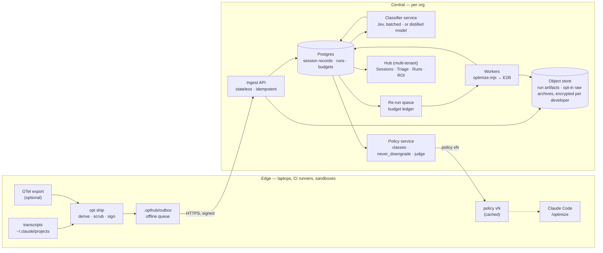

# opthub — Phase 1 Spec

**Status:** draft v0.4 · **Date:** 2026-09-30 · **Owner:** oleg@canarian.io
**Supersedes:** v0.3 (2026-09-29), v0.2 (2026-09-03), v0.1 (2026-08-24). v0.2 rebuilt the spec against measured data (§2).
v0.3 adds where sessions are stored today and how they are centralised and scaled (§5.3–§5.5).
v0.4 opens epic RO, runtime optimization: `opt claude optimize` and LLM Ultra Light (§16, `docs/runtime-optimization.md`).

---

## 1. One-liner

`opthub` is a CLI installed on every dev laptop that ships with a sandboxed agent. It watches the
LLM traffic your code actually makes, and continuously proposes — or safely applies — optimizations
that cut cost and latency **without** moving accuracy, leaking data, or losing work.

The hard part is not finding optimizations. It is proving one is safe before it ships. Everything
below is built around that gate.

**v0.1 said that. A month of measurement did not weaken it — it produced a sharper argument for it
than the one v0.1 made up.** See §2.3.

---

## 2. What changed from v0.1, and why

v0.1 was written before any measurement. `docs/experiments.md` (E1, E1b) then measured a real month
on a real laptop. Roughly half of v0.1's specifics did not survive. The thesis did.

### 2.1 Claims that died

| v0.1 claim | Measured reality | Evidence |
|---|---|---|
| The unit of optimization is a **recurring workload** (`supportbot/classify`) | All programmatic traffic is **$7.49 of $508.39 — 1.5%**. One human at a keyboard is 98.5%. | E1-F2 |
| `cache-priming` is the headline optimizer, **−64.4%** | Measured cache hit rate is **96.6%**. The client already caches the whole prefix at 1h TTL. There is nothing to win. | E1-F4 |
| Five optimizers: cache-priming, tool-schema-slimming, context-pruning, prompt-compaction, model-routing | Not one of them addresses where the money is: **53.9% of spend is requests in sessions whose median context is ≥250k**. | E1-F5 |
| Demo on a seeded `supportbot` repo with synthetic tickets | The synthetic workload has a shape this machine does not have. The real history is a better demo and it already exists. | E1-F2, §12 |
| Latency gate = wall-clock p95 | Caching is a **TTFT** win, not a wall-clock win. One series hides the other. | cookbook F1 |
| Cost figures in v0.1 §11 (−41%, −31%) | Placeholders, never computed. | PROGRESS 2026-08-24 |

### 2.2 Claims that held under re-run

Re-measured 2026-09-03 against 2026-08-30. These moved by less than a point and are safe to build on:

- Interactive vs. programmatic split: **98.5% / 1.5%** (`sdk-cli` total is $7.49 in both runs, to the cent).
- Cache hit rate: **96.8% → 96.6%**.
- Cost concentrated in long sessions: **≥250k context = 52.9% → 53.9%** of spend.
- Model mix already at the top: **Opus 5 = 89.6% → 89.0%** of requests.
- Lever ratios: prefix-trim **20.4% → 20.5%**, effort **2.4% → 2.7%**, Sonnet ceiling **59.5%** both runs.
- The highest-frequency loop (381 title-gen fires) still has **no usage record anywhere on disk**.

### 2.3 The finding that rebuilt the spec

**The local evidence base deletes itself, and it deleted itself in the middle of this analysis.**

`cleanupPeriodDays` is unset, so Claude Code's 30-day default applies. Between two runs of the same
pinned command ~30 minutes apart on 2026-09-03:

| | run 1 | run 2 | |
|---|---|---|---|
| session files on disk | 567 | **561** | −6 |
| sessions in ledger | 216 | **214** | 3 deleted, 1 new |
| window cost | $549.98 | **$508.39** | −$41.59 |

Three sessions dated 2026-07-31 ($46.25) crossed the retention boundary and were removed while the
tool was being run. **8.9% of E1's spend no longer exists on disk.** The oldest surviving transcript
is 2026-08-05 — 29 days old. E1's run of record is permanently unreproducible, and the reproduce
command printed in `experiments.md` will return a different answer every day, forever.

The consequence for the product is the one that matters:

> **The TTL lever's sign flipped twice in one hour of wall-clock, and the second flip was caused by
> deletion, not by new traffic.**
>
> | run | 1h TTL | 5m TTL | verdict |
> |---|---|---|---|
> | E1 · 2026-08-30 | $422.02 | $426.05 | 1h wins by $4.03 |
> | E1b · 2026-09-03 run 1 | $449.43 | $445.12 | 5m wins by $4.31 |
> | E1b · 2026-09-03 run 2 | $417.71 | $406.25 | 5m wins by $11.46 |

A recommendation engine reading the aggregate would have told this user to keep 1h on Saturday,
switch to 5m on Tuesday morning, and switch harder thirty minutes later. **Nothing about the
workload changed. The window did.**

That is the strongest argument in the repo for the three things v0.1 already specced but justified
weakly — durable capture (§5), an immutable frozen baseline (§4), and a non-optional gate (§6) —
plus one it did not have: a **stability gate** (§6.5).

### 2.4 Why the aggregate was unstable — the mechanism

The month-level TTL number is a near-cancellation of two populations that want **opposite** settings.
Splitting the same 214 sessions by measured cache **write:read ratio**:

| write:read | sessions | spend | 5m TTL delta |
|---|---|---|---|
| **> 2.0** — writes cache, rarely reads it back | 95 | $86.81 | **+$12.75** (5m wins) |
| 1.0 – 2.0 | 5 | $12.50 | +$0.59 |
| 0.5 – 1.0 | 10 | $172.34 | +$6.27 |
| **< 0.5** — long sessions that amortize the write | 104 | $237.15 | **−$8.56** (1h wins) |
| **net** | 214 | $508.80 | **+$11.05** |

Two large opposed effects summing to a small residual. The residual's *sign* is set by whichever
sessions happen to still be on disk. **A global TTL is wrong for roughly half the spend either way.**

This generalizes past TTL, and becomes a spec rule (§6.6): **an optimizer must be proposed against
the population it actually helps, never against a portfolio aggregate.**

---

## 3. Problem

A team ships LLM features. Over three months:

- sessions grow unbounded; the same 250k-token prefix is re-sent on every turn for hours
- system prompts accumulate dead instructions and stale few-shots nobody removes
- tool schemas list 30 tools where the workload uses 4
- config knobs (cache TTL, breakpoints, reasoning effort) are set once and never re-derived
- nobody knows the p95, the $/1k requests, or whether last week's prompt edit hurt accuracy

Each is a known fix. None get done, because doing them means proving you didn't break anything, and
nobody has the eval harness handy at the moment they notice the problem.

And — the part v0.1 did not know — **the data you would need to prove it is on a 30-day timer.**

opthub's bet: **put durable capture, the eval harness, and the optimizer in the same loop, on the
laptop, and make the gate non-optional.**

---

## 4. Core concepts

**Session** — a single continuous conversation with a growing prefix. **The primary cost unit.**
v0.1 did not have this concept; E1 showed it is where the money is (53.9% of spend in sessions at
≥250k context; the top 2 sessions are 53.9% of the month).

**Workload** — a named, recurring LLM call site in the repo. Still supported, still the right unit
for service traffic. No longer assumed to be the majority of spend.

**Trace** — one captured request/response pair: messages, model, tools, tokens, latency, cost,
redaction map. Captured at the wire, stored by opthub, **never** read back from a store opthub does
not own.

**Baseline** — a frozen golden set of N sampled traces per workload or session archetype, plus the
scores they earn under the current configuration, **pinned into CAS by content hash**. The thing
every candidate is measured against. §2.3 is why "frozen" is load-bearing rather than tidy.

**Optimizer** — a pure function `(Config, Traces) → CandidateConfig + rationale`. Stateless,
sandboxed, no side effects.

**Detector** — an optimizer's mandatory first half: measure the current state and **emit nothing**
if the headroom is already taken. `cache-priming` is a detector on this machine, not an optimizer
(E1-F4). New in v0.2; see §6.7.

**Proposal** — a candidate that has passed all gates, carrying its evidence bundle.

**Task** — one unit of journaled, resumable work. Everything opthub does is a task.

---

## 5. Architecture

```
┌── dev laptop (host) ─────────────────────────────────────────────┐
│                                                                   │
│   opthub CLI ──────────► opthubd (daemon, unprivileged)           │
│                              │                                     │
│         ┌────────────────────┼─────────────────────┐              │
│         │                    │                     │              │
│   capture proxy        journal (SQLite WAL)    apply engine       │
│   :7777                 + CAS artifact store    (only writer)     │
│         │               ── opthub-owned, no TTL ──                 │
│         │  redact-on-write                                         │
│         ▼                                                          │
│   traces ──────────────► [ agent sandbox: Docker ]                │
│                          ├─ repo mounted READ-ONLY                │
│                          ├─ egress allowlist (provider API only)  │
│                          ├─ no host creds — brokered short tokens │
│                          └─ emits signed Proposal, nothing else   │
│                                                                    │
└────────────────────────────────────────────────────────────────────┘
```

### 5.1 Trust boundary — unchanged from v0.1, still the load-bearing decision

**The agent that proposes optimizations can never write to your repo, and never sees raw secrets.**

| | agent sandbox | opthubd (host) |
|---|---|---|
| repo access | read-only bind mount | read/write |
| secrets | short-lived scoped token, brokered | reads keychain |
| network | egress allowlist, DNS pinned | normal |
| output | a signed `Proposal` JSON, nothing else | applies proposals after gates |
| crash blast radius | container dies, task resumes | journal replays |

The agent is treated as untrusted. It produces a *description* of a change. The host-side apply
engine is the only component that mutates anything, and it re-runs the gates itself before writing —
it does not trust the sandbox's claim that gates passed.

### 5.2 Capture — now with three independent reasons, all measured

Dev points their SDK at the local proxy:

```bash
export ANTHROPIC_BASE_URL=http://127.0.0.1:7777
```

The proxy is pass-through: it forwards upstream unmodified and records.

1. **Transcript stores are incomplete.** The highest-frequency loop on this machine — Claude Code's
   own session-title generation, 381 fires — writes a `user` record with no matching assistant
   record: no model, no token counts, no cost, anywhere on disk. It cannot be costed at all from
   transcripts. (E1-F3)
2. **Transcript stores are not durable.** 30-day default retention silently deleted $46.25 of
   evidence mid-analysis. (§2.3)
3. **Redaction must happen before disk.** Configured detectors (email, phone, API key, JWT, PAN,
   plus custom regex) replace matches with stable pseudonyms (`«email:a3f»`) so a trace stays
   semantically replayable without holding the real value. The reverse map never leaves the host
   keychain and never enters the sandbox.

Capture is opt-in per project and off by default. `opthub capture --status` always shows what is
being recorded.

**Retention is opthub's own policy, not the host application's.** Captured traces live in
`.opthub/cas/` until a `opthub gc` the user runs deliberately. An analysis that cannot be re-run is
not evidence.

### 5.3 Where sessions live today — *added in v0.3, as built on 2026-09-29*

Everything below is on **one machine**. Nothing is shared between developers, and nothing survives
the machine.

| # | what | where | written by | kept for | holds | sensitivity |
|---|---|---|---|---|---|---|
| 1 | **Transcripts** | `~/.claude/projects/<cwd-slug>/<session-id>.jsonl`; subagents as sidechain records and `agent-*.jsonl` | Claude Code | **30 days** by default (`cleanupPeriodDays`), deleted silently; this machine set 3650 on 2026-09-29 — a per-machine fix, not a policy | every prompt, reply, tool call and tool output, usage per request | **high** — file contents, and `!` shell input verbatim (an API key was recorded this way on 2026-09-29) |
| 2 | Session index | memory of the hub process, rebuilt from #1 on every `/api/sessions` (`lib/sessions-index.mjs`, `lib/watch.mjs`) | `opt hub` | process lifetime | cost, context, tools, artifacts per session | medium — first prompt shown as `intent` |
| 3 | Session-end signal | `$STATE/results/.session-log.jsonl` | Stop hook `hooks/on-session-end.mjs` | forever | session id, cwd, time | low |
| 4 | Ledger | `experiments/session-triage/data/private/ledger.csv` | `tools/savings.py` | until overwritten | cost split, model mix, context, `first_prompt`, session id | medium |
| 5 | Features, tasks | `…/data/private/features.jsonl`, `tasks.jsonl` | `extract.py`, `tasks.py` | until overwritten | counts and yes/no flags; task titles (prompt text, scrubbed) | low / medium |
| 6 | Classification | `$STATE/results/triage.json` | `export_hub.py` | until overwritten | Jev's classes, best/worst case, re-run queue | medium (task titles) |
| 7 | Experiment runs | `$STATE/results/exprun-*/`, `optrun-*/`, `replay-*/` | `optimize.mjs`, `replay-real.mjs` | forever | arm configs, costs, diffs, verdicts, report | medium — code produced by arms |
| 8 | Pinned ledgers | `docs/data/*.csv` (this repo, public) | by hand, stripped | forever | the runs of record, no prompts, `~` paths | low |

`$STATE` is the e2b checkout, or `OPT_HOME` when set (the brew wrapper sets `~/.opthub`).

**What this layout cannot do**, in order of cost:

1. **Sandbox sessions are invisible.** Arms run `claude --no-session-persistence` inside an E2B
   microVM, so their transcript dies with the VM; only the result JSON comes back. Phase 2's claim
   (§3.3 of `docs/demo-thesis.md`) is about exactly those sessions.
2. **The evidence expires.** #1 deletes itself at 30 days by default (§2.3), and #4–#6 are recomputed
   from it. Raising `cleanupPeriodDays` (this machine: 3650) fixes one machine; it does not make the
   evidence shared, durable beyond a disk, or present on any machine that has not been configured.
3. **One developer, one machine.** No team view, no cross-machine comparison, no central budget.
4. **Raw and derived data sit side by side**, so sharing the derived half means reasoning about the
   raw half every time.
5. **No identity or schema.** A path is the project key (`~/workspace/demos/opthub`), which differs
   per machine; files have no version field.

### 5.4 Centralising — raw stays at the edge, derived records travel

**The rule:** transcripts never leave the machine that produced them. What travels is the
**derived session record** J3 already computes — numbers, flags and classes — plus experiment
results. That turns "centralise the sessions" from a data-exfiltration question into a metrics
question.

| tier | contents | lives | leaves the machine? |
|---|---|---|---|
| **raw** | transcripts (#1), captured traces (§5.2) | edge: `~/.claude/projects`, archived into `.opthub/cas/` before the 30-day TTL | **never** by default; opt-in encrypted archive per developer |
| **derived** | one session record (below) | edge, then central | **yes** — counts, flags, classes; no text |
| **derived + text** | task titles, first request | edge; central only if the org opts in | opt-in, scrubbed (secret patterns, e-mail, `KEY=value`, home paths) |
| **results** | experiment runs: configs, costs, verdicts; arm diffs optional | central | yes |

**The session record** (`schema: opthub.session/1`) — assembled from what #4–#6 already hold:

```yaml
schema: opthub.session/1
session_id: 8b28d80d-…            # Claude Code's UUID — globally unique already
org: canarian                     # tenancy
developer: dev_7f3a               # pseudonym; the mapping stays with the org's IdP
machine: mac_19c2                 # stable per install
environment: laptop | sandbox | ci
project: { remote_hash: sha256(git remote), label: "demos/opthub" }   # not a path
window: { start, end, span_min, resumed_days }
usage: { requests, models: {claude-opus-5: 593}, ctx_p50, ctx_max,
         cost: { total, cache_read, cache_write, output, thinking } }
features: { reply_gap_p50, topic_breaks, tool_share: {…}, prompt_flags: {…}, work_signals: {…} }
artifacts: { count, bytes, kinds: [html, py] }        # names only if text is opted in
classes: { urgency, latency, deferral, capability, context,
           classifier: { model: jev-1.13.0, taxonomy: 0.1, confidence: {…} } }
saving: { best, worst, levers: [context-split, batch] }
rerun: { needed, experiment, verdict_ref }
```

Record size measured on this machine: **~0.9 KB median, 3.8 KB max** (65 sessions). Idempotency key:
`(session_id, sha256(record))` — a resumed session re-ships and replaces its record.

**Three sources feed it, in order of preference:**

1. **Transcript sweep** (built): `savings.py` → `extract.py` → `tasks.py` → classify. Complete, but
   only as durable as #1.
2. **Claude Code telemetry** (to verify): Claude Code can export OpenTelemetry metrics and events
   (per-request model, tokens, cost; tool results) when `CLAUDE_CODE_ENABLE_TELEMETRY=1` and an
   OTLP exporter are set. That gives usage without parsing files and reaches sandboxes. Confirm the
   current event set against Claude Code's monitoring docs before depending on it.
3. **Capture proxy** (§5.2, specced): wire truth, including the title-generation calls no
   transcript records.

**Collection on each machine — `opt ship`:**

- Triggered by the Stop hook that already exists (#3), plus a sweep on `opt hub start`, so a
  missed hook costs a delay, not data.
- Computes the record locally, applies the org's scrub policy, signs it with the machine key, and
  POSTs it. Offline: queue in `.opthub/outbox/`, retry with backoff.
- `opt ship --dry` prints exactly what would leave, field by field, and the hub shows the same view.
- In a **sandbox**: drop `--no-session-persistence` (or copy `~/.claude/projects` out before
  teardown), run `opt ship` inside the VM with `environment: sandbox`, then let the transcript
  die with the VM. Only the record comes back. This closes gap 1.

### 5.5 Architecture at scale



| component | responsibility | scales by | replaces today's |
|---|---|---|---|
| `opt ship` | derive, scrub, sign, queue, send | one per machine | nothing — new |
| Ingest API | validate schema, dedupe, write | stateless replicas behind a load balancer | nothing |
| Postgres | records, runs, budgets, policy versions; row-level security per org/team | partition `session_record` by month; read replicas for the hub | `triage.json`, `results/*/status.json` |
| Object store | run artifacts, reports, opt-in raw archives | unbounded | `results/` dirs |
| Classifier service | one Jev call per new or changed record; re-classify on a taxonomy version bump; key held centrally, never on laptops | batch size, rate limit | `run.py` on a laptop with a pasted key |
| Re-run queue + workers | run `unclear` sessions in E2B, blind-judge, write verdicts | worker count × E2B concurrency; **bounded by the budget ledger, not by hardware** | `triage-rerun.mjs` + a lock file |
| Budget ledger | per org/team daily cap, charged at *actual* spend after each arm | — | the $20 batch cap in one process |
| Policy service | versioned policy pushed to the edge (§8) | cacheable, tiny | `config/optimizations.json` in a checkout |
| Hub | same UI, reading Postgres, scoped by role | stateless replicas | `opt hub` over local files (stays, for offline and single-developer use) |

**Sizing, from this machine's numbers.** One developer: ~1.8 sessions/day (65 in 36 days), 64
requests per session at the median, ~1 KB per record.

| | 1 developer | 100 developers | 1,000 developers |
|---|--:|--:|--:|
| session records / day | ~2 | ~180 | ~1,800 |
| record storage / year | ~1 MB | ~70 MB | ~700 MB |
| per-request rows / day (if request-level events are kept) | ~120 | ~12k | ~120k |
| Jev calls / day (one per record) | ~2 | ~180 | ~1,800 |
| re-runs / day at the measured 60% `unclear` rate | ~1 | ~110 | ~1,100 |
| **re-run spend / day at the measured $5–10 each** | ~$8 | **~$800** | **~$8,000** |

Storage, ingest and classification are trivial at every size — Postgres holds all of it. **The
re-runs are the cost that scales**, which is why the architecture puts a budget ledger in front of
the queue and why the classifier's `unclear` rate is the number to drive down: each point of it is
worth ~$80/day at 1,000 developers. In practice: re-run a *sample* per (project × class) cell, not
every session, and reuse a verdict across sessions in the same cell until the policy or the model
changes. At ~120k request rows a day, move request-level events to a column store (ClickHouse or
partitioned Postgres) and keep session records in Postgres.

**Management.**

- **Retention per tier:** raw — the host's 30 days, or the developer's own encrypted archive;
  derived records — 13 months (a full year of seasonality); run results — kept, because a verdict
  whose inputs are gone is not evidence (§6.5).
- **Access:** a developer sees their own sessions in full; a team lead sees team records and
  aggregates; FinOps sees cost fields only. Enforced by row-level security, not by the UI.
- **Deletion:** by `session_id`, `developer` or `project` — removes records and any opt-in text;
  run results keep only aggregates.
- **Schema:** `schema` is on every record; the ingest API accepts N and N-1; classifications
  carry the classifier and taxonomy versions, so a wording change re-classifies instead of mixing.
- **Audit:** the ingest log is append-only and hash-chained, the same design as the journal (§9.2).

**Rollout.**

| stage | who | what is added | today's pieces reused |
|---|---|---|---|
| **A — one machine** (now) | one developer | nothing | all of §5.3 |
| **B — team** | 5–20 developers | `opt ship`, one Postgres, the hub reading it, sandbox shipping | J3 derivation, hub UI, `triage-rerun.mjs` as the worker |
| **C — organisation** | many teams | tenancy, IdP pseudonyms, budget ledger, classifier service, policy service | the same record schema |

The schema is the contract that makes B and C additive: define it now, write it locally in stage
A (`triage.json` becomes a list of `opthub.session/1` records), and each later stage only adds a
place to send it.

---

## 6. The gate

Every candidate must clear five independent gates. Any failure kills the candidate. There is no
override flag in Phase 1 — that's deliberate.

### 6.1 Accuracy gate

Replay the golden set against the candidate. Score with a two-part scorer:

- **Deterministic checks** (fast, free, run first): JSON schema validity, required-field presence,
  tool-call name+arity match, refusal detection, regex assertions the dev declared.
- **LLM-as-judge** (only for free-text outputs): pairwise judge against the baseline output, with
  position-swap to cancel order bias. Judge model is pinned in policy and never one of the models
  being optimized *to*.

Pass condition: `candidate_score >= baseline_score - policy.accuracy.relative_drop_max` (default
`0.00` — must tie or win), with n ≥ 30 and a one-sided bootstrap CI that excludes regression.

#### 6.1.1 Judge backends — *added 2026-09-22*

The judge is a pluggable component. One backend is **pinned** in policy and produces the score of
record; any others are **shadow** judges that score the same pairs and are reported alongside, never
in place of, the pinned score. Rules that hold for every backend:

- Pinned by **exact version**, never a floating alias (`jev-1.13.0`, not `jev-latest`;
  `qwen3:32b-q8_0`, not `qwen3:latest`). Changing the pinned judge forces a baseline re-freeze (§13).
- Never one of the models being optimised *to* (`security.model_allowlist` and `judge` are disjoint).
- Position-swap on every pair; arms presented in randomised order with identities withheld.
- A shadow judge earns promotion to pinned only after **agreement ≥ `judge.min_agreement`** with the
  current pinned judge over ≥ `accuracy.min_samples` pairs. Until then its score is informational.
- The report names the judge, its version, and the agreement figure if it is a shadow.
- The judge's own cost and latency are charged to the verify budget (§6.4), not hidden.

| backend | kind | what it returns | cost | sandbox / dev-machine | notes |
|---|---|---|---|---|---|
| `claude-opus-5` | API, pinned default | six criteria 1–10 + pairwise preference | paid | egress `api.anthropic.com`, already allow-listed | the score of record today |
| **`jev`** (TypeSafe System One Choice, `jev-1.13.0`) | API, optional shadow | **n-way choice** over arms with per-arm probabilities and a confidence | paid, key in user config only | egress `api.typesafe.ai`; ~0.3–0.8 s per call | It is a *Choice* primitive, not a scorer: it answers "which arm is better" and cannot produce the 1–10 rubric. Use it for the pairwise half of §6.1 only. Its `confidence` is decisiveness across options, **not** correctness — never gate on it directly. Prior art: `docs/router-comparison.md` §1. |
| `ollama/<open-weights>` (e.g. `qwen3:32b`, `llama3.3:70b`, `gemma3:27b` — verify current tags) | local, optional shadow | six criteria 1–10 + pairwise | **free** (compute only) | no egress; needs the weights and ≥ 24–48 GB RAM/VRAM depending on model; `template/openmodel/` already serves Ollama | weakest judge, strongest provenance — bit-identical replays a year later. Expect low agreement on subtle diffs; useful as a tie-breaker and for smoke runs at zero API spend. |
| `gemini-flash` (Google AI Studio free tier), `groq/<model>` (free tier), OpenRouter `:free` models | API, optional shadow | six criteria 1–10 + pairwise | **free tier at time of writing** — rate-limited, may change; verify before relying on it | one egress entry each; keys in user config | fine for shadow scoring on small n; rate limits make them unsuitable as the pinned judge for `min_samples ≥ 30` runs under `daily_usd_cap`. |

A run with **no free-text outputs** never calls any judge; the deterministic checks decide. A run with
no hidden test suite falls back to the pinned judge only, and the report says so in its verdict.

### 6.2 Latency gate — two series, not one

TTFT and total wall-clock are **tracked and gated separately**. A caching change is a TTFT win and
close to a wall-clock no-op; gating on a single blended p95 hides both the win and any regression
underneath it. (cookbook F1)

```
candidate_ttft_p95  <= baseline_ttft_p95  * policy.latency.ttft_p95_regression_max   (default 1.05)
candidate_total_p95 <= baseline_total_p95 * policy.latency.total_p95_regression_max  (default 1.05)
```

Measured against warm cache for cache-related optimizers, cold for everything else, so caching can't
flatter an unrelated change.

### 6.3 Security gate

Static + differential checks on the candidate:

- no redaction detector disabled or weakened
- target model ∈ `policy.security.model_allowlist`
- no new egress destination vs. baseline
- data-residency tag of target model matches policy
- workload not in `policy.security.never_downgrade`
- prompt-injection surface: candidate must not newly interpolate untrusted content into the system
  prompt, or newly grant a tool the baseline didn't have

### 6.4 Economics gate

Verification costs real money. A candidate is only worth verifying if it can pay for itself:

```
projected_30d_savings > verification_spend * policy.budgets.min_roi   (default 3×)
```

opthub estimates verification cost before running it and skips candidates that can't clear it. Daily
verification spend is capped in policy; the cap is enforced in the daemon, not the sandbox.

### 6.5 Stability gate — **new in v0.2**

Earned directly by §2.3. A candidate whose advantage is not stable under resampling is not a
candidate, however large its point estimate.

The same proposal is scored on **k disjoint or bootstrapped sub-windows** of the baseline. It passes
only if:

```
sign(delta) is identical on all k sub-windows        # the direction never flips
and  |delta| > policy.stability.min_effect            # not a residual of opposed populations
and  bootstrap_ci_95(delta) excludes 0                # default k = 5
```

The TTL lever fails this gate on this machine — correctly, and that is the point. Its month-level
sign flipped three times in five days while the underlying workload did not change at all. A
point-estimate-only gate would have shipped a different answer each run.

**Corollary — provenance is part of the evidence bundle.** Every proposal records the content hash
of the exact trace set it was computed over. A proposal whose inputs no longer exist is marked
`STALE` and is never auto-applied.

### 6.6 Population rule

An optimizer must be proposed **against the population it helps**, never against a portfolio
aggregate. If the candidate's effect changes sign across an identifiable segment of the baseline,
the proposal must either carry the segment predicate or be rejected.

For TTL the predicate is measured and cheap — cache **write:read ratio** per session (§2.4). The
correct proposal is not "switch to 5m", it is:

```
sessions with write:read > 2.0  →  5m TTL   (+$12.75 over this window)
sessions with write:read < 0.5  →  1h TTL   (already correct)
```

### 6.7 Detector-first rule

Every optimizer ships its measurement half first, and stays silent when the headroom is gone.
`cache-priming` on a 96.6%-hit-rate client must emit **nothing** — not a small win, not a
low-priority proposal. An optimizer that fires when there is nothing to win is how a continuous
system becomes noise the user turns off. (E1-F4)

---

## 7. Optimizer catalog

Rebuilt from E1's scored use cases. Tier is *how much the change can move the sampled distribution*,
and tier sets default autonomy.

| Tier | Meaning | Default | Optimizers |
|---|---|---|---|
| **T0** | Token-identical. Cannot change the sampled distribution. | auto-apply | `cache-config` (TTL + breakpoint placement, gated per §6.6), `transport-tuning` |
| **T1** | Changes the request the model sees. Eval-gated. | auto-apply *if* policy allows and all gates pass | `prefix-trim`, `context-pruning`, `effort-tuning`, `tool-schema-slimming`, `output-shaping` |
| **T2** | Changes *who* answers or the shape of the session. | always propose | `context-lifecycle`, `model-routing` |

Ranked by E1's rubric — `2 × (0.40·Value + 0.25·Evidence + 0.20·GateEase + 0.15·BuildEase)`:

| # | Optimizer | UC | Tier | Score | Measured basis |
|---|---|---|---|---|---|
| 1 | **`context-lifecycle`** — cap session growth; compact / split / reset before the prefix ratchets past ~120k | UC-8 | T2 | **7.3** | 53.9% of spend is requests at ≥250k session context |
| 2 | **`prefix-trim`** — cut what is re-sent per turn: tool schemas, stale tool results, dead `CLAUDE.md` | UC-1 | T1 | **6.9** | lever A = $104.51 (20.5%) at an assumed 25% trim |
| 3 | **`model-routing`** — Opus 5 → Sonnet 5 on the subset that can prove it | UC-4 | T2 | **6.8** | lever D ceiling = $302.52 (59.5%); 89.0% of requests are Opus 5 |
| 4 | **`wire-capture`** *(infrastructure, not an optimizer)* | UC-5 | — | **6.7** | 381 title-gen fires have no usage record anywhere local |
| 5 | **`effort-tuning`** — `low`/`medium` where quality holds, within-model | UC-2 | T1 | **6.0** | lever B = $13.72 (2.7%) measured floor; 30% of output is thinking |
| 6 | **`cache-config`** — verify TTL / breakpoint changes against the trace before applying | UC-3 | T0 | **5.7** | §2.3: the naive change flips sign three times in five days |
| 7 | **`cache-priming`** — demoted to **detector** | UC-7 | T0 | **5.3** | 96.6% hit rate; nothing left to win |
| 8 | **machine-issued-turn governance** — the v0.1 centre of gravity | UC-6 | — | **5.0** | all `sdk-cli` traffic is $7.49, 1.5% of spend |

**Two calls worth arguing with.** `model-routing` has the biggest prize ($302.52 ceiling) and the
worst odds of passing §6.1 — on 89% of requests, on interactive coding, the workload where downgrade
risk is highest and the eval harness weakest. Keep it, size it, expect the gate to block it, and
treat a *blocked* routing proposal as a successful demo. And UC-6, the entire framing of v0.1, ranks
**last** on this machine; E4 is the test of whether it ranks first on a machine with real recurring
agents.

**Trust the levers accordingly.** Only the TTL lever is measured end-to-end. Prefix-trim's 20.5% and
effort's 2.7% are measured headroom under an *invented* trim percentage; the Sonnet ceiling assumes
token counts a smaller model probably would not hold. E2 and E3 exist to replace those assumptions,
and none of A/B/D may be quoted as a savings forecast until they do.

---

## 8. Policy

`opthub.policy.yaml`, committed to the repo, linted by `opthub policy lint`.

```yaml
version: 2

budgets:
  accuracy:  { min_score: 0.95, relative_drop_max: 0.00, min_samples: 30 }
  latency:   { ttft_p95_regression_max: 1.05, total_p95_regression_max: 1.05 }
  cost:      { target_reduction: 0.30 }
  verify:    { daily_usd_cap: 5.00, min_roi: 3.0 }

stability:                            # new in v0.2 — see §6.5
  subwindows: 5
  require_consistent_sign: true
  min_effect_usd_30d: 10.00
  max_baseline_age_days: 14

capture:
  retention: forever                  # opthub owns its store; never inherit a host TTL
  gc: manual

security:
  redaction: [email, phone, api_key, jwt, pan]
  egress_allowlist: [api.anthropic.com]
  model_allowlist:
    - claude-opus-5
    - claude-sonnet-5
    - claude-haiku-4-5-20251001
  judge_model: claude-opus-5          # pinned; never a routing target (kept for v0.2 compat; see judge:)
  data_residency: us

judge:                                # added 2026-09-22 — see §6.1.1
  pinned: claude-opus-5               # score of record; exact version, never an alias
  min_agreement: 0.85                 # a shadow must agree with pinned this often before promotion
  shadow:                             # scored alongside, reported, never gating
    - backend: jev                    # TypeSafe Choice — pairwise only, no 1–10 rubric
      model: jev-1.13.0
      endpoint: https://api.typesafe.ai/v1/systemone
      key: user-config                # never in this file, never in the sandbox image
      role: pairwise
    - backend: ollama                 # free, local, no egress
      model: qwen3:32b
      role: rubric+pairwise
    - backend: gemini                 # free tier at time of writing; rate-limited
      model: gemini-flash-latest      # TODO pin an exact version before trusting scores
      role: rubric+pairwise
  egress_extra: [api.typesafe.ai, generativelanguage.googleapis.com]
  never_downgrade:
    - supportbot/pii-extract

autonomy:
  default: propose
  auto_apply_tiers: [T0]
  auto_apply_optimizers:
    - tool-schema-slimming
  require_approval_optimizers:
    - model-routing
    - context-lifecycle
    - prefix-trim
  apply_mode: pr                      # pr | worktree | direct
```

---

## 9. Journal & recovery

Everything is a task; every task is a replayable event log. **Unchanged from v0.1** — this section
survived measurement intact, and §2.3 raised its importance.

### 9.1 Task state machine

```
PENDING → CAPTURING → BASELINING → OPTIMIZING → VERIFYING
                                                    │
                              ┌─────────────────────┴──────────┐
                              ▼                                ▼
                          PROPOSED ──apply──► APPLIED       REJECTED
                              │                  │
                           reject             rollback
                              ▼                  ▼
                          REJECTED         ROLLED_BACK
```

### 9.2 Storage

- **`.opthub/journal.db`** — SQLite in WAL mode. `events(task_id, seq, ts, type, payload_cas, prev_hash)`,
  append-only, hash-chained so tampering is detectable.
- **`.opthub/cas/<sha256>`** — content-addressed artifact store: traces, candidate configs, eval
  results, diffs. Events reference artifacts by hash, so the log stays small and replay is exact.

CAS is what makes §6.5's provenance requirement enforceable: a proposal names its input set by hash,
and opthub can tell you whether that exact input set still exists.

### 9.3 Idempotent side effects

Every effect that costs money or touches the world is written as a triple:

```
INTENT(effect_id, description, cost_estimate)
  → …perform…
EFFECT(effect_id, result_cas)
  → CONFIRM(effect_id)
```

On resume, any `INTENT` without a matching `CONFIRM` is checked against the provider (via
idempotency key) before being retried. **This is what makes `kill -9` mid-verification safe: resume
never re-pays for an eval run that already completed.**

### 9.4 Commands

```bash
opthub journal tail            # live event stream
opthub journal show <task>     # full timeline with artifacts
opthub resume                  # replay to last CONFIRM, re-enter state machine
opthub journal verify          # check the hash chain
opthub journal export <task>   # portable bundle for a bug report
```

---

## 10. CLI surface

```bash
opthub init                          # scaffold .opthub/, policy, gitignore
opthub daemon start | stop | status

opthub capture start --port 7777     # begin recording
opthub capture status                # what is being recorded, redaction on/off
opthub capture stop

opthub sessions list                 # cost by session, context growth curve   [new in v0.2]
opthub workloads list                # discovered call sites + current cost/latency
opthub detect                        # run detectors only; report headroom, propose nothing [new]

opthub baseline create --from 30d --n 50
opthub baseline show | freeze | verify   # `verify` = do my inputs still exist?  [new in v0.2]

opthub optimize [--workload W] [--session S] [--tier T0,T1] [--dry-run]
opthub proposals list | show <id>
opthub proposals apply <id> [--as-pr]
opthub proposals reject <id> --reason "..."
opthub rollback <apply-id>

opthub claude optimize [dir]         # runtime optimization: Claude Code in the sandbox behind ULT  [v0.4, §16]
opthub claude optimize audit --verify # decisions of a live run; check the hash chain               [v0.4]

opthub report --since 7d             # the dashboard, in terminal
opthub policy show | lint
opthub resume
```

### Exit-code contract

`0` ok · `10` accuracy gate · `11` latency gate · `12` security gate · `13` ROI too low ·
`14` **stability gate** · `15` **baseline stale — inputs no longer exist** · `20` sandbox
unavailable · `30` journal inconsistent, resume required.

---

## 11. Demo script

**v0.1 demoed a synthetic `supportbot`. v0.2 demos the real laptop history**, because the measured
shape of real usage is the thing v0.1 got wrong, and because the numbers below are reproducible from
`tools/` today.

**Act 1 — Observe (90s).**
`opthub capture start`, then `opthub sessions list`. 214 sessions, $508.80. The screen shows the
concentration immediately: **top 2 sessions = 53.9% of the month**, and **53.9% of spend sits in
requests at ≥250k context**. Cache hit rate 96.6% — already excellent, and the naive optimizer is
therefore already dead.

**Act 2 — The detector says nothing (30s).**
`opthub detect`. `cache-priming` reports *"hit rate 96.6%, no headroom, no proposal"*. This is the
optimizer v0.1 called its −64.4% headline. **A product that stays quiet when there is nothing to win
is the first thing to show.**

**Act 3 — Optimize, and get told "no" twice (2 min).**
`opthub optimize`. The sandbox emits candidates; gates run live:

| candidate | tier | accuracy | TTFT | cost | verdict |
|---|---|---|---|---|---|
| `cache-config` → 5m TTL | T0 | tie (token-identical) | — | **−$11.05** | ❌ **REJECTED — stability gate** |
| `prefix-trim` | T1 | 0.96 → 0.96 | −6% | −20.5% ⚠ modelled | ⏸ proposed |
| `effort-tuning` → medium | T1 | 0.96 → 0.96 | −11% | −2.7% | ✅ auto-applied |
| `context-lifecycle` @120k | T2 | 0.96 → 0.95 | −31% | −38% | ⏸ proposed (needs approval) |
| `model-routing` → Sonnet 5 | T2 | 0.96 → **0.88** | −24% | −59.5% | ❌ **REJECTED — accuracy gate** |

**The two rejections are the product.** One candidate is thrown away for losing 8 accuracy points —
the biggest dollar number on the screen, $302.52, killed by the gate. The other is thrown away
*despite* being token-identical and provably cheaper on the current window, because its sign flipped
three times in five days.

**Act 4 — Show why the TTL candidate was rejected (60s).**
`opthub proposals show cache-config`. The evidence bundle prints §2.4's population table: +$12.75 on
95 write-heavy sessions, −$8.56 on 104 read-heavy ones, netting a residual whose sign is set by which
sessions are still on disk. Then it prints the segmented proposal that *does* pass — TTL by
write:read ratio — and offers that instead.

**Act 5 — Crash & recover (60s).**
Mid-verification: `kill -9 $(pgrep opthubd)`. `opthub resume` → `⤷ resuming task t_8f21 at
VERIFYING, 34/50 evals already CONFIRMED, skipping`. Finishes the remaining 16. Re-spend: **$0.00**.

**Act 6 — The number (30s).**
`opthub report --since 30d`: applied savings, two candidates rejected with reasons, one rollback
available, and — the closing line — **"baseline inputs: 214/214 present"**, next to the note that the
host's own transcript store lost $46.25 of this window while you were watching.

---

## 12. Phase 1 scope

### Build

- `opthubd` daemon: capture proxy, journal, CAS, apply engine, gate runner
- Docker agent sandbox with read-only mount + egress allowlist
- **Five gates** incl. stability (§6.5) and the population rule (§6.6)
- Optimizers, in rank order: `context-lifecycle`, `prefix-trim`, `effort-tuning`, `cache-config`,
  plus `cache-priming` **as a detector only**
- `model-routing` built to be *demonstrably blocked*, not shipped
- Two-part scorer (deterministic + pinned judge)
- CLI as specified in §10
- `opthub report` terminal dashboard, demoed on real captured history

### Explicitly deferred

- Fleet/team aggregation · non-Anthropic providers (interface stubbed) · IDE extension ·
  web dashboard · `batch-collapse` and `transport-tuning` · Windows support
- `supportbot` seed repo — **cut.** E1-F2 says the synthetic recurring-workload shape is 1.5% of real
  spend; the real history is the better demo and needs no seeding.

---

## 13. Risks

| Risk | Mitigation |
|---|---|
| **Evidence base evaporates under a host TTL** | opthub owns its store; capture retention is `forever` by default; baselines pinned by content hash; `baseline verify` reports missing inputs; proposals over vanished inputs marked `STALE` (§5.2, §6.5) |
| **A lever's sign is a sampling artifact** | Stability gate (§6.5) + population rule (§6.6) |
| Golden set overfits; gate passes but prod regresses | Rotate held-out slice each run; report score on unseen traces separately |
| Judge drift makes scores incomparable over time | Judge model pinned in policy; changing it forces baseline re-freeze |
| Devs see the capture proxy as a MITM on their traffic | Opt-in per project, off by default, local-only bind, `capture status` always truthful, redact-before-disk, source published |
| Verification costs more than it saves | ROI gate (§6.4) + hard daily cap in daemon |
| Agent sandbox escape | Read-only mount, no host creds, egress allowlist, output limited to signed JSON, host re-runs gates independently |
| "Continuous" becomes noisy | Detector-first rule (§6.7); proposals deduped by candidate hash; a rejected candidate is not re-proposed until its inputs change |
| **n=1 machine** — the whole evidence base is one laptop building opthub | Every claim in §2 tagged with which run measured it; E4 tests the loop-shaped case; treat §2.2 (stable across runs) as build-on-able and §2.1 as directional |

---

## 14. Open questions

1. **Call-site fingerprinting** — file:line is brittle under refactor. Prompt-template hash + a
   stable `opthub.workload("name")` annotation? Leaning annotation-optional, fingerprint-fallback.
2. **Where does an applied T0 change live?** A generated `opthub.lock.json` the SDK shim reads, or a
   real diff in the source? Leaning source diff for T1/T2, lock file for T0.
3. **Journal per-repo or per-machine?** E1 sharpened this: cost concentrates in *sessions*, which
   are per-machine, and cross-project routing insight needs the machine view. v0.1 specced
   per-repo. **Now leaning per-machine (`~/.opthub/`) with per-repo policy.** v0.3: per-machine at
   the edge, and a central store of derived session records keyed by session id and a project
   identity derived from the git remote, not the path (§5.4).
4. **Does the agent need write access to a scratch worktree** for optimizers that must run the repo's
   own tests? Would widen the trust boundary; deferred past Phase 1.
5. **What is the right sub-window count `k` for the stability gate?** Default 5 is a guess. Needs an
   experiment that replays known-good and known-unstable levers at k ∈ {3,5,10}.
6. **Does `context-lifecycle` need to be T2?** It is the top-ranked optimizer and its default is
   "always propose", which may make the highest-value lever the least-used one. E5 should measure
   whether a conservative reset threshold is safe enough for T1.

---

## 15. Provenance

Every number in §2, §7 and §11 comes from a script in `tools/`, run on the date named.

```bash
python3 tools/loopscan.py --since 2026-07-30                  # month aggregate, loops, TTL check
python3 tools/savings.py  --since 2026-07-30 --top 15 \
        --csv docs/data/e1b-sessions.csv                      # per-session ledger + levers
```

- **E1 run of record** — 2026-08-30, `docs/data/e1-sessions.csv`, 215 sessions, $518.73.
  **No longer reproducible** (§2.3).
- **E1b run of record** — 2026-09-03, `docs/data/e1b-sessions.csv`, 214 sessions, $508.80.
  Will also decay. That is the finding, not a caveat.

---

## 16. Runtime optimization — epic RO (*added in v0.4*)

Phase 1 measures a session after it happened. Epic RO acts while it happens: `opt claude optimize` starts
Claude Code inside the Docker sandbox with the developer's terminal attached, and every request goes
through **LLM Ultra Light (ULT)**, a router inside the sandbox boundary. ULT classifies each request
(rules, then Jev when rules are unsure, with per-project context persisted between sessions), decides
`keep`, `route` to a cheaper remote model, or `local` to an Ollama model, and writes every decision
to a hash-chained audit log (§9.2 format). The agent is a level of the command,
`opt <agent> optimize`, so agents other than Claude Code can be added.

Three rules carry over from the measurements:

1. **Shadow first.** The default mode records decisions and changes nothing. Routing is opt-in.
2. **Cache-aware economics.** A main-thread route re-buys the prefix uncached (94–99.9% of Claude
   Code input is cache reads, `docs/evidence-catalog.md`), so a route needs an estimated saving,
   and a routed thread stays on its target.
3. **The credential stays out of the agent.** ULT holds it; the agent container has a dummy key and
   reaches nothing but ULT and the egress proxy.

The full epic — stories, components, flags, configuration, audit schema, what is deferred and why —
is `docs/runtime-optimization.md`. Implementation lives in `app/`: `optimize-live.mjs`,
`ult.mjs`, `lib/ult/`, `config/ult.default.json`.

