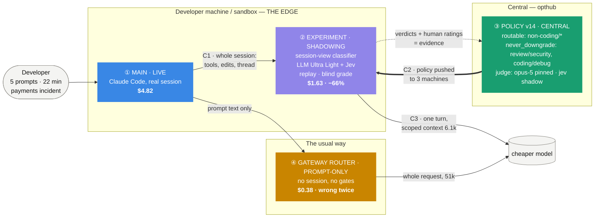
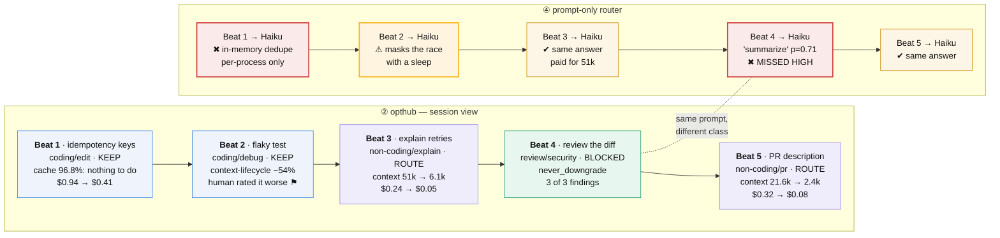
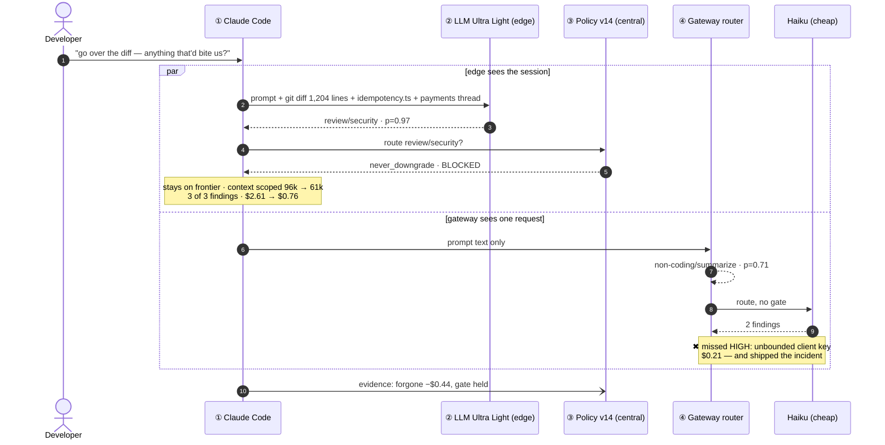
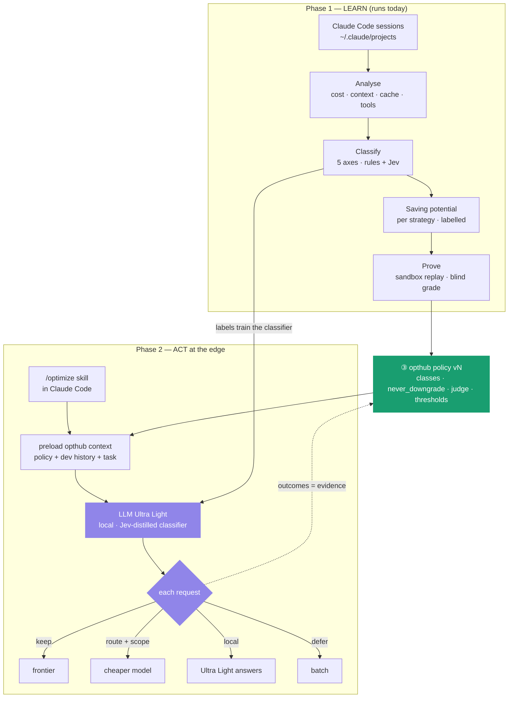
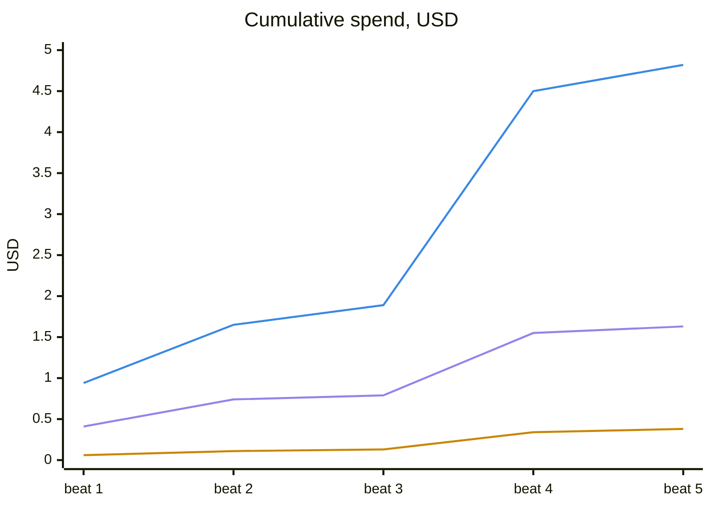

# opthub — demo diagrams

**Source of truth:** `docs/demo-mock-spec.md` v0.2 (the four-terminal demo) and `docs/demo-thesis.md`.
Every number here is copied from the spec's per-beat table (§5); change it there first.

**To convert:** each block is plain Mermaid.
- **Slides / PNG / SVG:** `mmdc -i docs/demo-diagrams.md -o docs/screens/diagrams/demo.svg`
  (one file per block), or paste a block into [mermaid.live](https://mermaid.live) and export.
- **Hand-drawn look:** Excalidraw → *More tools → Mermaid to Excalidraw* (flowcharts convert to
  editable shapes; the sequence diagram and chart come in as images).
- **draw.io:** *Arrange → Insert → Advanced → Mermaid*.

Colors are the spec's pane accents (§1): ① blue `#3987e5` · ② violet `#9085e9` ·
③ aqua `#199e70` · ④ yellow `#c98500` · critical `#d03b3b`.

---

## 1. The stage — four panes, three claims

What the audience sees, and what flows between the panes. C1/C2/C3 are the claims in spec §0.1.

---

## 2. The five beats — what the edge decided, what the router did

One row per beat. Top lane: opthub at the edge. Bottom lane: the prompt-only router.
Keep = stays on frontier · Route = cheaper model with scoped context · Blocked = policy said no.

---

## 3. Beat 4, one request — why the decision has to live at the edge (C1)

The thesis of the demo in one exchange. Same prompt; two classifiers; only one can see the session.

---

## 4. Phase 1 → Phase 2 — the product behind the demo

The demo shows Phase 2's decision; Phase 1 is where the classifier and the savings come from.

---

## 5. The money — cumulative spend over the five beats

Spec §7.1 series. Blue = ① actual · violet = ② opthub, all gates passed · yellow = ④ router, no gates.

**Closing line under the chart:** actual **$4.82** · opthub **$1.63 (−66%)**, every gate passed ·
router **$0.38 (−92%)**, *$1.25 cheaper than opthub and wrong twice*.
