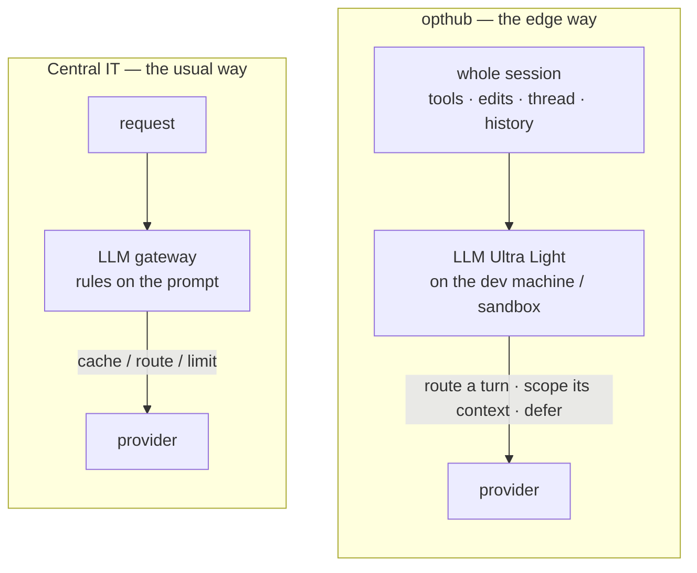
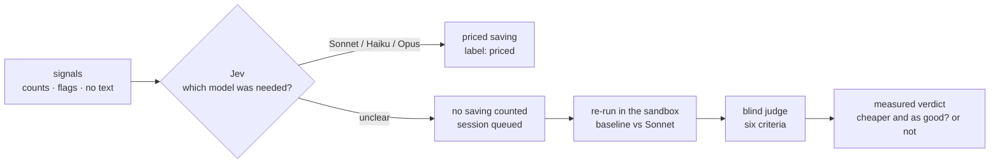
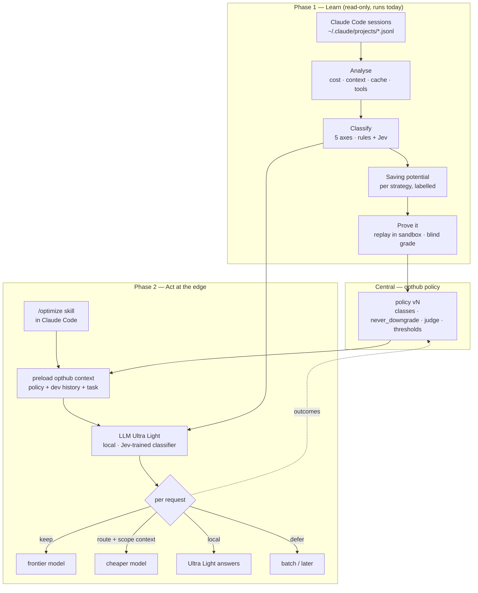
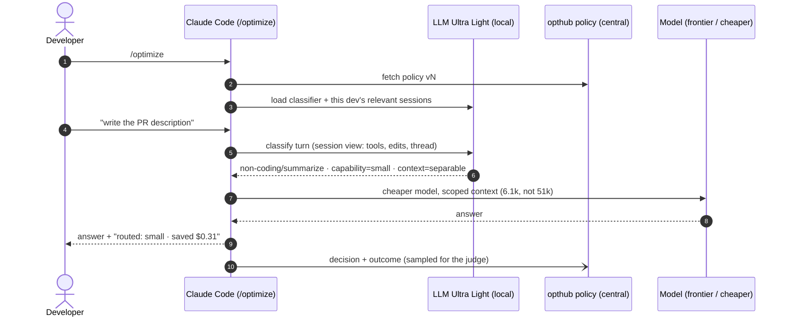

# opthub — developer demo thesis

**Status:** draft v0.1 · **Date:** 2026-09-29 · **Audience:** developers and engineering leads
**Companion:** `docs/demo-diagrams.md` (five demo diagrams built from `docs/demo-mock-spec.md`; PNG/SVG in `docs/screens/diagrams/`) — paste any block into
[mermaid.live](https://mermaid.live), Excalidraw → *Mermaid to Excalidraw*, or draw.io → *Arrange → Insert → Mermaid*.

---

## 0. The thesis in three sentences

1. There are many proven ways to cut LLM spend, and almost all of them are applied **centrally** —
   by IT or a platform team, at a gateway, on one request at a time.
2. opthub **learns from every session a developer's coding agent runs** (Claude Code first), turns
   each into an analysed, classified session with a **saving potential per strategy** — and then
3. brings the decision to the **edge**: an *optimization mode* skill in Claude Code, backed by a
   local **LLM Ultra Light** with a Jev-trained classifier, that decides per request using what it
   knows about this task and this developer. **In a sandbox, where nobody is waiting, that decision
   has the most room to save.**

---

## 1. The landscape — how everyone else optimizes

Published figures from 2026 vendor and practitioner write-ups. They are **claims about generic
workloads**, not measurements on ours — the right column is what our own month of data says.

| # | Strategy | Published saving | Who usually applies it | Where | What our data says (E1/E1b, 214 sessions, $508.80) |
|---|---|---|---|---|---|
| 1 | **Prompt caching** | 45–90% of input cost | platform team | client / gateway | **Already 96.8% hit rate** — nothing left to win. Demoted to a *detector*. |
| 2 | **Model routing** (cheap model for easy requests) | 40–85% | central IT | gateway (Kong, LiteLLM, Portkey, hosted routers) | Ceiling 59.5% (→ Sonnet) / 67.8% (→ Haiku) — *priced*, not measured. The prompt-only decision is the risk. |
| 3 | **Semantic caching** (reuse answers to near-duplicate prompts) | 30–50% | central IT | gateway + vector store | Coding sessions rarely repeat a question verbatim; not in our catalog as runnable. |
| 4 | **Context optimization** (prune, compact, split) | 30–60% | nobody centrally — it needs the session | client | **Our top lever.** 52.9% of spend is sessions with median context ≥250k. Ceiling 20.5%. |
| 5 | **Batch API** (−50% for non-urgent work) | 50% | central / job owners | client | Floor **−$854** → ceiling +$254: batch loses the cache, so it can *cost more*. |
| 6 | **Budgets, rate limits, attribution** | indirect | central IT / FinOps | gateway | Governance, not saving. We keep it central (§4, C2). |
| 7 | **Local / open-weights model offload** | 50–99% (router vendors) | individual developer | laptop (Ollama + claude-code-router) | One replay: **7.1× cheaper, 18 points worse** (n = 1). Cheap is easy; *same job* is the question. |

Sources: [Morph](https://www.morphllm.com/llm-cost-optimization) ·
[IntuitionLabs](https://intuitionlabs.ai/articles/llm-prompt-caching-cost-savings) ·
[Digital Applied — routing](https://www.digitalapplied.com/blog/llm-model-routing-2026-cost-quality-optimization-engineering-guide) ·
[Maxim — gateways](https://www.getmaxim.ai/articles/best-enterprise-ai-gateway-to-reduce-llm-token-cost-in-2026/) ·
[TrueFoundry](https://www.truefoundry.com/blog/llm-cost-optimization) ·
[claude-code-router](https://github.com/musistudio/claude-code-router) ·
prior art in `docs/router-comparison.md`.

**The line to say on stage:** *the published number for the most popular lever is 45–90%. On a real
developer's month it is zero, because it is already on. The money is somewhere a gateway cannot see.*

### Why the central approach tops out

A gateway sees **one request**. It does not know which tools ran, whether files were edited, how deep
the thread is, whether someone is waiting, or what this developer did yesterday. So it can switch the
model, but it **cannot shrink the context** — and context length is where the money is (E1-F5).

---

## 2. Phase 1 — learn from sessions (runs today, read-only)

Every Claude Code session leaves a transcript. opthub reads them all and produces, per session:

1. **An analysed session** — cost, requests, median/max context, cache read/write mix, thinking share,
   tool mix, reply gaps (the Hub's *Sessions* and *Analytics* views).
2. **A classification**, on two kinds of input:
   - **predefined classes** — five axes in `experiments/session-triage/taxonomy.json`:
     `urgency` · `latency` (was a person waiting?) · `deferral` · `capability` (least tier that does
     the job) · `context` (did later turns need the whole history?). Every axis has `unclear`, and
     `unclear` never unlocks a lever.
   - **retrieved features** — C0 (ledger metadata) and C1 (local transcript features: reply gaps,
     topic breaks, tool mix, seven prompt flags, work signals — §2.1). Prompt text is matched locally
     and dropped; only counts and booleans leave the machine. The cost is never shown to the classifier.
   - classifiers: `rules`, **Jev** (TypeSafe decision model), and `hybrid` (rules first, Jev fills
     only what rules left `unclear`).
3. **Saving potential per strategy** — each figure labelled by how much to trust it:

| Strategy | Lever | Ceiling on our ledger | Label |
|---|---|--:|---|
| context-lifecycle / context-split | scope or split the history | $104.51 (20.5%) | `guess` |
| route-mid | Sonnet 5 for `capability = mid` turns | $302.93 (59.5%) | `priced` |
| route-small | Haiku 4.5 for `capability = small`, ≤200k context | $344.95 (67.8%) | `priced` |
| prefix-trim | drop dead tool schema / preamble | 20.4% | `guess` (E2 will measure) |
| effort-tuning | lower thinking effort | 2.4% | `guess` (E3 will measure) |
| cache TTL (5m ↔ 1h) | per population | measured; sign flips | stability gate |
| batch | defer non-urgent sessions | −$854 → +$254 | `priced` / `guess` |
| cache-priming | — | 0 (96.8% hit) | `detector` |
| fast mode | Opus fast | reported as **spend**, never netted | `priced` |
| **LLM Ultra Light (local)** | run a turn locally | 7.1× cheaper, −18 pts (n = 1) | experiment |

Stacking rule: route first, then context on what is left, then batch — **no dollar saved twice**
(`SPEC.md` R1). These are headroom numbers; the experiment loop (re-run the real session in a sandbox,
blind-grade the arms) is what turns one into a finding.

**The Phase 1 punchline** (J3): 28 interactive sessions are **$501 of $509 (99%)**. Rules can settle the
186 cheap SDK sessions from the entry point alone, but on the 28 that matter they answer `unclear` —
nothing in a cost ledger says whether someone was waiting. **That gap is the classifier's job.**

### 2.1 Signal methodology — what Jev sees, and what happens when it cannot answer

**Signals are counts and yes/no flags computed on the developer's machine.** Jev gets one request per
session with five multiple-choice questions, and every question can be answered `unclear`.

| signal group | taken from | examples | reaches Jev as |
|---|---|---|---|
| session metadata (C0) | the cost ledger (`tools/savings.py`) | entry point, project *kind*, requests, median/max context, thinking share, start time | numbers, a category |
| activity (C1) | the transcript | reply gaps (median, p90), pauses over 30 min, span, days spanned, tool mix, subagent share | numbers |
| prompt flags (C1) | the person's prompts, matched locally | mentioned a deadline · production/incident · demo/meeting · background/later · research · docs · fix/test | seven booleans |
| **work signals** (C1) | tool calls and their results in the transcript | files touched, lines changed, files edited 3+ times, test runs and failures, tool errors, commits | counts |
| never sent | | prompt text, file paths, code, **cost** (a model shown "$137" calls the session hard because of the price) | — |

**What each round of signals bought**, on the live 30-day ledger (54 sessions, $1,832):

| evidence | which model was needed | could it wait |
|---|---|---|
| C0, metadata only | `unclear` on every session (0.94–1.0 confidence) | `unclear` on every session |
| C1, + activity and prompt flags | `unclear` on 54 of 54 | answered on 34 of 54 |
| C1, + work signals | **answered on 22** (21 Sonnet, 1 Haiku), `unclear` on 32 | answered on 34 of 54 |

**When Jev says `unclear`, the sandbox answers — it is never turned into a signal.**

- The re-run replays the session's request in an E2B sandbox twice — the session's own model and
  Sonnet — and a judge scores both without knowing which is which (`route-cheaper-frontier`).
- Its verdict is reported next to the classification and is **not fed back to Jev as an input**. It
  can later serve as an answer key for scoring Jev, which is evaluation, not a signal.
- Spend guards: plan-only by default, ≤ $6 per session (two arms × $3), a batch cap, one batch at a
  time, a stop button (`triage-rerun.mjs`, Hub → Triage).
- Known limit: a session is replayed from its first prompt. A long session is many tasks
  (the largest is 16), so the next step is to replay per task.

**What the sandbox arms can change.** Beyond the model, an arm now varies the proxy and the client
(`lib/arm-config.mjs`, catalog `config/optimizations.json`):

| layer | knob | catalog entry |
|---|---|---|
| LiteLLM · routing | named routes next to the `*` upstream; subagents and Claude Code's small-fast calls sent to Sonnet while the main loop stays | `litellm-route-side-calls` |
| LiteLLM · cache | `cache_control_injection_points` on the system prompt; exact-match response cache with a TTL | `litellm-cache-inject`, `litellm-response-cache` |
| LiteLLM · budget | proxy-wide `max_budget` / `budget_duration`, counted where the requests are served | `litellm-proxy-budget` |
| Claude Code · env | `CLAUDE_CODE_SUBAGENT_MODEL`, `ANTHROPIC_DEFAULT_HAIKU_MODEL`, `MAX_THINKING_TOKENS`, `CLAUDE_CODE_MAX_OUTPUT_TOKENS`, any other var | `claude-thinking-cap` |
| Claude Code · flags | `--max-turns`, `--fallback-model`, `--append-system-prompt` (plus the existing `--effort`, `--autocompact`, `--max-budget-usd`) | `claude-max-turns` |
| Claude Code · settings | `.claude/settings.json` written into the sandbox workdir | (per arm) |

Without a route, every request — main loop, subagents, session titles — lands on the one upstream, so
an Opus baseline pays Opus prices for titles. A routed arm is priced per model from Claude Code's
`modelUsage`, so the saving is not hidden by charging every token at the main model's rate.

---

## 3. Phase 2 — actionable optimization at the edge

### 3.1 The developer's experience

1. At session start, the developer types `/optimize` (a Claude Code skill) — **optimization mode** on.
2. opthub **preloads the context that decisions need** — the *opthub context*: central policy
   (routable classes, `never_downgrade` classes, accuracy threshold, pinned judge), this developer's
   session history and classes, and the task at hand.
3. **LLM Ultra Light** starts locally, **configured on the fly** with the Jev-trained classifier and
   the sessions relevant to this task and this developer.
4. On **every request** it decides: keep on frontier · route this turn to a cheaper model with a
   **scoped context** · run it locally · defer it — or leave it alone. It prints the decision and
   why, and the developer can override (`/optimize pin frontier`).
5. Decisions and outcomes flow back to the central policy (the judge's verdicts tighten or widen the
   rules). **Governance stays central; the decision is local.**

### 3.2 One request in optimization mode

### 3.3 Why the sandbox is where it counts

On a laptop a person is waiting on each reply, so latency caps what the edge may do. In a **sandbox**
(agents running unattended — CI fixes, background refactors, eval runs), the `latency` axis is
`unattended` by construction, which unlocks every lever a laptop blocks:

| | laptop (interactive) | sandbox (unattended) |
|---|---|---|
| someone waiting? | yes | no |
| route to cheaper / local model | per turn, carefully | per turn, freely |
| defer / batch | rarely | yes, where the cache shape allows |
| local model latency penalty | felt by the developer | irrelevant |
| egress / privacy | open | allow-listed — **local model means fewer allow-list entries** |
| how opthub runs there already | Hub + `opt watch` | Docker sandbox (8 verified guarantees), E2B microVMs |

**Honest status:** this is a *claim to prove*, not a result. On the one ledger we have, unattended
(SDK) sessions are only $7.49 of $508.80 — one developer's month is interactive. The sandbox
significance has to be shown on a sandbox workload: run the same task set in the Docker sandbox with
and without optimization mode, three repeats, blind-graded.

---

## 4. The three claims the demo must make visible

Carried from `docs/demo-mock-spec.md` §0.1 — the Phase 2 story is the same three claims:

| # | Claim | On screen |
|---|---|---|
| **C1** | The decision lives on the developer's machine, in the session — not as rules on a gateway. | Each turn prints `gateway view (prompt only)` beside `session view (opthub)`; they disagree on the security review, and the prompt-only router ships the bug. |
| **C2** | Rules and metrics are central and feed the judge. | `policy v14` pushed to 3 machines; every verdict names the pinned judge; edge outcomes flow back into the rule. |
| **C3** | Route **parts** of a session by class, never the session. | PR description and explanation turns route with a scoped context; coding turns stay on frontier. |

## 5. Demo run of show (≈12 min)

| # | Beat | Shows | Built? |
|---|---|---|---|
| 1 | "Everyone optimizes centrally" — §1 table | landscape, and our 96.8% cache hit | ✅ data |
| 2 | Hub → Sessions → sort by cost | analysed sessions, 99% in 28 sessions | ✅ Hub (`opthub-demo.fly.dev`) |
| 3 | Hub → **Triage**: classification + best/worst case per session, tasks, re-run state | Phase 1 output | ✅ Jev run on the real API (54 sessions); 🟡 Sonnet re-runs for `unclear` in progress |
| 4 | Experiment loop: replay one session, blind-graded | "cheaper *and* the same job?" — 7.1× cheaper, 18 pts worse | ✅ recorded run |
| 5 | `/optimize` in Claude Code, five turns | C1 / C3 live | 🔴 skill + Ultra Light not built — use the four-terminal mock |
| 6 | Same task in the sandbox, with and without | the sandbox claim | 🔴 needs the sandbox run in §3.3 |
| 7 | Central policy + report | C2 | 🟡 in the mock |

## 6. What to build before the demo, and the questions to expect

**Build**
1. **`/optimize` skill** — loads policy + context, calls Ultra Light per turn, prints decisions.
2. **LLM Ultra Light** — a small local model (Ollama) plus the classifier. Recommended: *distil* Jev —
   Jev labels sessions offline, the local classifier is fitted on those labels, so the per-request
   decision costs ~0 ms and no API call (`docs/optimizers.md` §3.4: *don't add a call to save a call*).
3. ~~Jev arm on the real API~~ (done 2026-09-29). Still needed: ~20 gold labels, and per-task replay for long sessions.
4. **Sandbox A/B** — same task set, with/without optimization mode, 3 repeats.

**Questions the room will ask**
- *"Isn't this just claude-code-router?"* — CCR routes by request type from config. opthub decides
  from the session, scopes the context, and proves the saving by blind-graded replay.
- *"What does the router itself cost?"* — Jev in the hot path adds ~0.7 s per turn (Alexei's
  measurement). That is why Ultra Light is local and distilled.
- *"Does quality drop?"* — the one local-model replay says yes, by 18 points. The gate exists to say no
  to that; the demo should show a rejection, not only wins.
- *"n = 1?"* — yes, today. Three repeats before quoting a figure.
