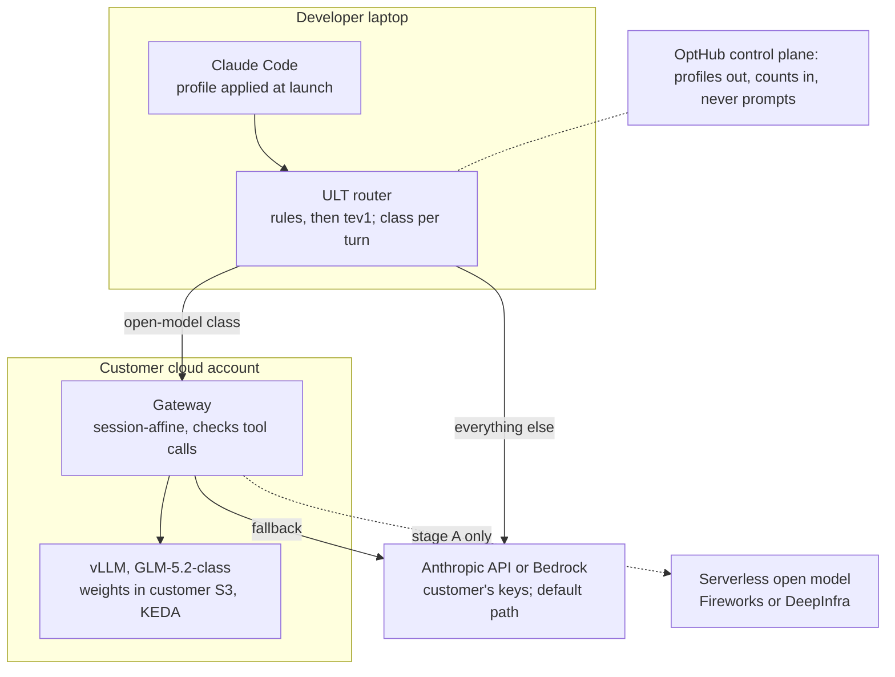

# Managed inference stack for a per-customer open-weights model

**Status:** analysis, 2026-10-24 · **Owner:** oleg@canarian.io · **Companion:** [`release-plan-v1.md`](release-plan-v1.md)
· **Numbers:** `python3 tools/hostcost.py` over [`data/e1b-sessions.csv`](data/e1b-sessions.csv), rate card `tools/ratecard.py` 2026-10-24.
Prices and versions as fetched on 2026-10-24. Labels follow CLAUDE.md: `priced` (list rates, a ceiling), `guess`, measured.

A per-customer hosted model does not pay for a first customer. At Anthropic's $250 per developer-month
average, a small model has to undercut Haiku 5.5 and never breaks even, because its replicas grow with
headcount; a GLM-5.2-class node against Sonnet 5.5 breaks even at 155–726 developers on DeepInfra and
304–1,552 on AWS, assuming equal quality that nothing has measured. Heavy users cut these by about a third.
Staying on Anthropic comes first: configuration, task-boundary sessions, Haiku 5.5 for subagents and batch
save 25.5–42.5% of the bill with no fixed cost, and against the bill that is left the GLM-class break-even
rises to 208–1,263 developers on DeepInfra. Until a customer clears that, test the open-model hypothesis on a
serverless endpoint with zero fixed cost, one routed class at a time, behind the replay gate. vLLM is the
engine when hosting is justified, and residency is the one reason to self-host early.

## Savings on Anthropic first

Before any hosting, Anthropic-only changes cut a $250 Opus 5.5 developer-month by $63.76–106.37 (25.5–42.5%)
with no fixed cost; a hosted tier is then measured against the bill that is left. Each step acts on what the
steps before it left (SPEC R1), so the rows add up to the total. Section 6 of `tools/hostcost.py`.

| Step, in applied order | Saved per developer-month | Share of what was left | Basis | Label |
| --- | --- | --- | --- | --- |
| Claude Code configuration (8 levers) | $32.00 | 12.8% | `dynconfig.py`, last two weeks on the development machine; 5.4 points measured ([`dynamic-config-analysis.md`](dynamic-config-analysis.md)) | measured + priced + guess |
| New session per task, prompted at task boundaries | $11.72–23.43 | 5.4–10.8% | The 21.5% `/clear` ceiling, 25–50% of it captured | priced × guess |
| Subagents and side calls on Haiku 5.5 | $20.04–47.25 | 9.7–24.3% | 10–25% of the remaining spend moved; on short-context work Haiku costs 2.86% of Opus | priced × guess |
| Batch API for async machine work | $0–3.68 | 0–2.5% | 0–5% of the remaining spend is waitable; batch is 50% off | priced × guess |
| **Total** | **$63.76–106.37** | **25.5–42.5% of the bill** | Bill left: $143.63–186.24 | |

Left out of the total: the main loop on Sonnet 5.5 (a 20.8% priced ceiling, but replays measured it 2.4–3.9×
more expensive per task, n=2); fast mode off (none on the development machine; 50% of fast-mode spend where
used); US-only inference off (9.1% of that spend); stale Opus 5 or 4.8 pins moved to Opus 5.5 (20% of that
spend, priced). The configuration figure predates `tools/ratecard.py`'s 5.5 cache-read price; re-run
`dynconfig.py` before quoting it to a customer.

Measured against what is left, the Sonnet-class slice a hosted model displaces shrinks with the bill, and the
GLM-5.2-class break-even rises (range = smaller to larger Anthropic saving):

| GLM-5.2-class, 8×H200 | 25% of the remaining spend routed | 50% routed |
| --- | --- | --- |
| DeepInfra, 24×7 | 974–1,263 | 487–632 |
| DeepInfra, 12 h × 22 days | 416–539 | 208–270 |
| AWS on demand, 24×7 | 2,083–2,701 | 1,042–1,351 |
| AWS on demand, 12 h × 22 days | 817–1,059 | 409–530 |

After the Anthropic savings, a 500-developer customer clears the node comfortably only with a 12-hour warm
pool on DeepInfra at 50% routed (208–270). At 25% with that warm pool, at 50% always on, or on AWS with a warm
pool at 50%, it sits on the line (409–632); every other case needs 817 developers or more.

## Four ways to host

Serverless first, because it tests the one open question, whether an open model holds quality on the
customer's work, with no fixed cost. Dedicated and BYOC are for customers whose volume or residency demands them.

| Way | Fixed cost | Prompt cache on Claude Code traffic | Residency | Ops for us | When |
| --- | --- | --- | --- | --- | --- |
| Serverless open weights behind an Anthropic-compatible endpoint (Fireworks, DeepInfra) | None | Automatic, listed cached prices | Provider regions; none in Israel | None | Pilot: replay-graded quality test |
| Dedicated managed endpoint (DeepInfra, Fireworks, Baseten) | $2.90–13 per GPU-hour | Engine prefix cache, near free if KV stays resident | Provider regions; Fireworks and Baseten BYOC on Enterprise | Low | Past the break-even below |
| BYOC: vLLM on the customer's EKS, Anthropic fallback | AWS H100 $6.88 per hour on demand | Same, with session-affine routing | In country only on A10G or A100: il-central-1 has no H100 or newer | About 0.1 engineer per endpoint, version pinning | A residency-bound customer past break-even |
| Shared base in our cloud, per-customer LoRA | Spread across customers | Per-tenant `cache_salt`, SHA-256 prefix hashes | Ours | Medium | Three or more customers on one base model |

A shared cache leaks, through response timing, whether another tenant's prefix is cached; per-tenant salting
closes that between customers but not to the operator ([Tinfoil](https://tinfoil.sh/blog/2026-07-14-secure-prompt-caching)).
vLLM's docs warn that runtime adapter loading is not for production unless the environment is fully trusted.

## Economics

The price of a cached token decides the bill, so a hosted tier has to beat Haiku 5.5's $0.01 cache read for
Haiku-class work and Sonnet 5.5's $0.10 for Sonnet-class work. Same E1b traffic, $ per 1M input tokens with
output included (`priced`):

| Tier | $ per 1M input | vs Opus 5.5 |
| --- | --- | --- |
| Haiku 5.5, prompt ≤ 100K | $0.0200 | 0.03× |
| gpt-oss-120b · Fireworks | $0.0238 | 0.04× |
| DeepSeek V4.1 Flash · Fireworks | $0.0244 | 0.04× |
| GLM 5.3 Flash · Fireworks | $0.0376 | 0.06× |
| MiniMax M3 · Fireworks | $0.0766 | 0.13× |
| Haiku 5.5 on a main thread (75.5% of input $ past 100K) | $0.0802 | 0.13× |
| Haiku 5.5, prompt > 100K | $0.0998 | 0.16× |
| Qwen3-Coder-480B · DeepInfra | $0.1139 | 0.19× |
| Sonnet 5.5 | $0.3025 | 0.50× |
| MiniMax M2.5 · Bedrock (no cache price, billed uncached) | $0.3085 | 0.51× |
| GLM 5.3 · Fireworks | $0.3297 | 0.54× |
| Qwen3 Coder Next · Bedrock (no cache price, billed uncached) | $0.5085 | 0.84× |
| Kimi K3 · Bedrock | $0.5229 | 0.86× |
| Opus 5.5 | $0.6050 | 1.00× |

Open models billed without a cache price cost as much as Sonnet 5.5 or more on this traffic, up to 84% of
Opus 5.5. Haiku's price applies only to prompts up to 100K tokens; subagents and side calls start fresh and stay at $0.020.

| Dedicated endpoint, per customer | Hours | $/month with ops, one replica | Displaces | Break-even developers, 25% / 50% routed |
| --- | --- | --- | --- | --- |
| Small model, 1×H100 replicas, DeepInfra or AWS | 24×7 or 12 h × 22 days | $3,057–7,314 | Haiku 5.5 | Never |
| GLM-5.2-class, 8×H200, DeepInfra | 24×7 | $22,673 | Sonnet 5.5 | 726 / 363 |
| GLM-5.2-class, 8×H200, DeepInfra | 12 h × 22 days | $9,663 | Sonnet 5.5 | 310 / 155 |
| GLM-5.2-class, 8×H200, AWS on demand | 24×7 | $48,486 | Sonnet 5.5 | 1,552 / 776 |
| GLM-5.2-class, 8×H200, AWS on demand | 12 h × 22 days | $18,998 | Sonnet 5.5 | 608 / 304 |

Inputs: $250 per developer-month on Opus 5.5 (Anthropic's enterprise upper average), ops at 10% of a
$275,000-a-year GPU engineer, quality assumed equal. A small-model replica holds about 20 live 35K-token
sessions (Qwen3-Coder-30B-class KV, derived from its config, not measured), so replicas multiply with
headcount and each costs more per developer than the Haiku work it displaces. The 8-GPU rows leave capacity
out: GLM-5.2's KV size is not known here. Heavy users ($388 a month, the development machine with dynconfig's
old 0.1× cache-read price corrected) cut the GLM-class break-even by about a third. The ops share, the
12-hour warm pool, peak concurrency and equal quality are `guess`.

A 45-developer customer clears none of these. A 500-developer customer clears the GLM-5.2-class node on
DeepInfra at 50% routed, or at 25% with a 12-hour warm pool, and only if quality holds, which no replay has tested.

Memory, not compute, is the limit. An active developer needs about 22 tokens/s of new prefill and 4.6
tokens/s of output, but at the 142K-token median request SemiAnalysis measured on Claude Code traces (V),
one H100 holds 5 live sessions, not 20.

## Providers compared

Fireworks is the closest fit for a managed per-customer tier: it serves the Anthropic Messages API on both
serverless and dedicated deployments, caches automatically, and isolates tenants by header. No managed
provider found serves open-weight models inside Israel.

| Provider | Anthropic `/v1/messages` | Prompt cache for open models | Dedicated $/GPU-hr | Per-tenant or BYOC | Israel / EU |
| --- | --- | --- | --- | --- | --- |
| [Fireworks](https://docs.fireworks.ai/tools-sdks/anthropic-compatibility) | Yes, serverless and on-demand; no `count_tokens` | Automatic; 80–98% off on serverless | H100 or H200 $8, B200 $13; per second; scale to zero after 1 h idle, first request 503 | `x-prompt-cache-isolation-key`; BYOC in private preview, Enterprise | No Middle East; EU Frankfurt and Iceland at 1.5× |
| [DeepInfra](https://docs.deepinfra.com/integrations/anthropic) | Yes, with `count_tokens` | Listed cached prices | H100 $2.90, H200 $3.49, B200 $4.89; via sales | U | Region not stated |
| [Baseten](https://docs.baseten.co/reference/inference-api/messages) | Beta; rejects `x-api-key` and extra body fields | Automatic, session pinning | H100 ≈$6.50, B200 ≈$9.98; per minute; cold starts billed | Self-hosted, VPC or hybrid on Enterprise | Custom regions via sales |
| [Together](https://docs.together.ai/docs/dedicated-endpoints/pricing) | No; Together Link is a hosted Claude Code gateway (beta) | Automatic | H100 $5.49, B200 $8.99; no true scale to zero | U | EU on Scale and Enterprise |
| [AWS Bedrock](https://aws.amazon.com/bedrock/pricing/) | Mantle Messages documented for Claude only; open models need a translator | Only GLM 5.3 and Kimi K3 list cache prices | Custom Model Import ≈$3.43 per CMU-hour, 5-minute windows, weights under 200 GB, context under 128K | Runs in the customer's account | bedrock-runtime in il-central-1, but new models only via global profiles; CMI not in il-central-1 |
| [Vertex AI](https://cloud.google.com/vertex-ai/generative-ai/pricing) | No; OpenAI-compatible | Implicit, best effort | Self-deploy ≈$11.27 per H100-hour, no scale to zero (V) | Customer's project | me-west1 U |
| [Azure Foundry](https://learn.microsoft.com/en-us/azure/foundry/foundry-models/concepts/models-sold-directly-by-azure) | No for open models | DeepSeek V4, Kimi K2.5+ | U | Customer's subscription | Israel Central not listed |
| Vendor APIs: [Moonshot](https://platform.kimi.ai/docs/guide/claude-code-kimi), [Z.ai](https://docs.z.ai/devpack/tool/claude), [DeepSeek](https://api-docs.deepseek.com/guides/anthropic_api) | Yes, built for Claude Code | Yes | — | No | Not EU or Israel |

Strict Israeli residency means self-hosting in the customer's il-central-1 account or a provider's BYOC
inside it. Model churn is real: Moonshot retires the Kimi K2 series by end of 2026, Groq retired three coding
models in 2026, and several hosts dropped Qwen3-Coder-480B for Qwen 3.5–3.8. Route by capability class, never
by a fixed model name.

## Serving engines

vLLM is the default: it serves the Anthropic Messages API natively, so Claude Code needs no translator, and it
has the widest tool-parser coverage for current coding models. Prompt-cache accounting is the weak spot in every engine.

| Engine | Version, Oct 2026 | Native `/v1/messages` | Prefix cache | Multi-LoRA | Use for OptHub |
| --- | --- | --- | --- | --- | --- |
| [vLLM](https://docs.vllm.ai/en/latest/serving/integrations/claude_code/) | v0.32.0 | Yes, with `count_tokens`, thinking, tool_use, `defer_loading`; no `cache_control` field | Automatic, on by default; CPU and tiered offload | Yes, MoE LoRA since 0.15 | Default engine |
| [SGLang](https://docs.sglang.io/docs/basic_usage/anthropic_api) | v0.5.21 | Yes; needs `--tool-call-parser` | RadixAttention, HiCache tiers | Yes, 8 per batch by default | Alternate; a streaming bug on multi-tool turns is reported |
| [NVIDIA Dynamo](https://docs.dynamo.nvidia.com/dynamo/reference/releases) | v1.6.0 | Yes; release notes say production, docs matrix says experimental | KV-aware router, cache-salt per tenant | Dynamic LoRA | Defer: multi-node scale |
| [llm-d](https://github.com/llm-d/llm-d), [KServe](https://github.com/kserve/kserve/releases) | v0.9.0, v0.20.0 | From the engine | Prefix-aware routing | From the engine | Defer; scale to zero via KEDA |
| [Ollama](https://docs.ollama.com/api/anthropic-compatibility) | v0.40.10 | Yes since v0.14.0; no `cache_control`, `tool_choice`, `count_tokens` | In-process only | Not a focus | Laptop tier only |
| [llama.cpp](https://huggingface.co/blog/ggml-org/anthropic-messages-api-in-llamacpp) | b11829 | Yes, with `count_tokens` | In-process | U | Edge only |
| [NVIDIA NIM](https://docs.api.nvidia.com/nim/docs/product) | 2.0.13 | Yes, through vLLM | From vLLM | Yes | Skip: vLLM at $4,500 per GPU-year |
| [TGI](https://github.com/huggingface/text-generation-inference) | archived 2026-03-21 | No | — | — | Do not use |

Five rules carry over to any engine:

- **Route each session to one replica** on `x-claude-code-session-id`. Claude Code reuses 85–97% of the prompt
  between calls on the same worker ([NVIDIA Dynamo, agentic inference](https://docs.nvidia.com/dynamo/digest/agentic-inference)).
- **Keep the prefix stable.** Claude Code's attribution block is stable per conversation from v2.1.181; set
  `CLAUDE_CODE_ATTRIBUTION_HEADER=0` on older clients.
- **Do not bill from the engine's cache counters** until each is checked: `cache_read_input_tokens` may be
  missing or wrong, and Dynamo only fixed double counting in v1.4.
- **Test tool calls on replayed transcripts.** Malformed calls cluster in streaming and long contexts; the
  gateway falls back to Anthropic when a call does not parse.
- **Pin versions.** vLLM ships a minor release about every two weeks, and each one needs the conformance replay again.

One node per tenant does not need disaggregated prefill and decode: vLLM's docs say it does not raise
throughput, and the only agentic evidence for it is a simulation. KV offload to CPU or disk helps only under
memory pressure; on 739 Claude Code traces LMCache cut average first-token time from 102 s to 35 s at 32 users
and 100K context, and lost at 8 users and 32K.

## Models

GLM-5.2 is the only open model with an independent near-frontier result on fresh tasks, so it is the hosted
candidate; on a laptop, prefill speed rules out everything but small MoE models.

| Tier | Model | Why | Limit |
| --- | --- | --- | --- |
| Laptop, Mac 32–128 GB | Qwen3.6-35B-A3B (Apache-2.0) | Fastest Mac prefill of a capable model, about 2.5–3.1K tokens/s at 8K | 24.7 on SWE-rebench: short single-step calls only |
| Laptop, 128 GB | Qwen3-Coder-Next at Q8 (85 GB) | No thinking step, stronger edits | Tight on 64 GB |
| Workstation, one 24–32 GB GPU | Qwen3.8-27B (Apache-2.0) | Vendor SWE-bench Pro 61.7; a 47K first turn in about 20–30 s (estimated) | No independent score yet |
| Hosted, one node | GLM-5.2 (MIT, 753B) | SWE-rebench 62.9, beside Opus 5 at 63.4 and above Sonnet 5 at 56.8 | Needs 8×H200 at FP8 (about 753 GB of weights) |
| Hosted, cheaper | GLM-5.3-Flash (MIT), DeepSeek V4/V4.1-Flash (MIT) | Fewer active parameters | DeepSeek V4.1-Flash scores 31.2 on Terminal-Bench 4.0, below Haiku 5.5 at 39.2 |
| Legal review before resale | MiniMax M3/M3.1, GLM-5.3, Qwen3.8-Max and Flash-Next, Kimi K3 | — | Licenses tightened in the second half of 2026 |

Benchmarks do not line up. Claude 5.5 reports Terminal-Bench 4.0 and SWE-bench Pro; open models report
SWE-bench Verified and Terminal-Bench 2.0 or 2.1. Independent Terminal-Bench 2.0 reruns land 9–15 points below
vendor claims ([Vals Terminal-Bench 2.0](https://benchmarklist.com/benchmarks/vals_terminal_bench_2/)), and
Qwen3.6-27B's vendor 77.2 on SWE-bench Verified sits beside 31.2 on [SWE-rebench](https://swe-rebench.com/).
Only a replay on the customer's own sessions settles quality.

Claude Code's first request carries about 45–50K tokens of system prompt and tools. One traced local run took
6 min 43 s to read it on a 64 GB Mac with a dense 27B model, then hit the client's 5-minute idle timeout. Local
models produce well-formed tool calls 94–97% of the time at Q4, which compounds to about 66% over eight steps
by the author's arithmetic; Q3 breaks tool use.

## Reference architecture for a one-customer pilot

The pilot runs in three stages and stops at the first one whose gate fails; every stage keeps Anthropic as the
default path and the fallback.

1. **Stage A, serverless.** ULT sends one open-model class to a serverless endpoint with zero data retention
   and a per-tenant cache isolation key (Fireworks), shadow first, then on a replay-graded slice. No fixed cost.
   Gate: blind-judged quality ties Sonnet 5.5 on that class at n ≥ 3, and the routed volume from the customer's
   scan clears the break-even.
2. **Stage B, dedicated managed.** The same model on a dedicated deployment once volume clears the break-even.
   Gate: cost per accepted task below Sonnet 5.5 on the same replays.
3. **Stage C, BYOC.** Only for a customer whose residency rules require it: vLLM on the customer's EKS, one
   deployment per tenant, KEDA on `vllm:num_requests_waiting` with a p95 latency guard, weights streamed from
   the customer's bucket, and a thin gateway that routes on `x-claude-code-session-id` and sends cold starts,
   overload and unparsed tool calls to Anthropic. Defer Dynamo, llm-d disaggregation and LMCache until one
   tenant fills more than a node.

In Israel, stage C runs on A10G or A100 only (il-central-1 has no H100 or newer as of 2026-10-24); the nearest
AWS H100 and B200 capacity is Stockholm.

## Risks and disconfirmations

1. **Unsupported path.** Anthropic's docs say it does not support routing Claude Code to non-Claude models
   through any gateway. Each Claude Code release can add beta fields that an open upstream rejects; set
   `CLAUDE_CODE_DISABLE_EXPERIMENTAL_BETAS=1` for open targets and re-run the conformance replay on every release.
2. **Quality is unmeasured on customer work.** OptHub's one open-weights replay came back 7.1× cheaper and 18
   points worse (n=1), and vendor scores run 9–15 points above independent reruns.
3. **Switching models costs the cache.** In GitHub Copilot agent traces the hit rate fell to about 8% after a
   model switch and by a median 66% after compaction ([Microsoft Research](https://www.microsoft.com/en-us/research/wp-content/uploads/2026/08/ghcp_traces-6.pdf)).
   Route whole threads at boundaries, never single turns.
4. **Engine cache counters are not billing-grade.** `cache_read_input_tokens` may be absent or wrong per engine;
   savings are priced from Anthropic's usage fields, never from an open engine's.
5. **Memory pressure.** 59.4% of production coding sessions saw a KV eviction, and evictions caused 31.5% of
   aggregate cost ([arXiv 2608.15127](https://arxiv.org/pdf/2608.15127)). A small box fills fast.
6. **Prices move against self-hosting.** AWS raised Capacity Block GPU prices about 15% on H200 lines in
   January, about 20% in July and again for B200 in October 2026, while Anthropic cut Sonnet 5.5's cache read to
   $0.10 on 7 October.
7. **Churn and licenses.** Moonshot retires the Kimi K2 series by end of 2026; GLM-5.3, MiniMax M3 and
   Qwen3.8-Max carry commercial conditions.
8. **Residency.** No managed provider found serves open models inside Israel; AWS il-central-1 offers A10G and A100 only.
9. **Ops load.** A fully loaded GPU infrastructure engineer costs about $275,000 a year; on one H100, a tenth of
   that is more than the GPU.

## Data: input and output, cached and uncached

Every figure above comes from these three tables (section 7 of `tools/hostcost.py`). Two shapes are used:
**all sessions** (the whole E1b ledger) for Sonnet-class comparisons, and **short-context** (the 206 sessions
whose median request is at most 100K tokens) for Haiku-class work. The ledger folds uncached input into
cache reads, so uncached input is not a separate line in the volumes; Anthropic's own `/usage` example puts it
at about 0.1% of input.

**Rates, $ per 1M tokens** (fetched 2026-10-24). Open-model hosts with automatic caching bill a cache write as
plain input; Bedrock's explicit cache writes cost 1.25× input with a 30-minute TTL; "none" means no cache price
is listed, so every input token bills as uncached input.

| Tier | Uncached input | Cache write 5m | Cache write 1h | Cache read | Output | Source |
| --- | --- | --- | --- | --- | --- | --- |
| Opus 5.5 | 4.000 | 5.000 | 8.000 | 0.2000 | 20.00 | `tools/ratecard.py` |
| Sonnet 5.5 | 2.000 | 2.500 | 4.000 | 0.1000 | 10.00 | `tools/ratecard.py` |
| Haiku 5.5, prompt ≤ 100K | 0.100 | 0.125 | 0.200 | 0.0100 | 0.50 | `tools/ratecard.py` |
| Haiku 5.5, prompt > 100K | 0.500 | 0.625 | 1.000 | 0.0500 | 2.50 | `tools/ratecard.py` |
| gpt-oss-120b · Fireworks | 0.150 | 0.150 | 0.150 | 0.0150 | 0.60 | [Fireworks](https://fireworks.ai/pricing) |
| DeepSeek V4.1 Flash · Fireworks | 0.300 | 0.300 | 0.300 | 0.0060 | 1.20 | [Fireworks](https://fireworks.ai/pricing) |
| GLM 5.3 Flash · Fireworks | 0.150 | 0.150 | 0.150 | 0.0300 | 0.50 | [Fireworks](https://fireworks.ai/pricing) |
| MiniMax M3 · Fireworks | 0.300 | 0.300 | 0.300 | 0.0600 | 1.20 | [Fireworks](https://fireworks.ai/pricing) |
| Qwen3-Coder-480B · DeepInfra | 0.300 | 0.300 | 0.300 | 0.1000 | 1.00 | [DeepInfra](https://deepinfra.com/pricing) |
| GLM 5.3 · Fireworks | 1.400 | 1.400 | 1.400 | 0.2600 | 4.40 | [Fireworks](https://fireworks.ai/pricing) |
| Kimi K3 · Bedrock global | 3.000 | 3.750 (30m) | — | 0.3000 | 15.00 | [Bedrock](https://aws.amazon.com/bedrock/pricing/) |
| Qwen3 Coder Next · Bedrock US | 0.500 | — | — | none | 1.20 | [Bedrock](https://aws.amazon.com/bedrock/pricing/) |
| MiniMax M2.5 · Bedrock US | 0.300 | — | — | none | 1.20 | [Bedrock](https://aws.amazon.com/bedrock/pricing/) |

**Token volumes per developer-month**, Opus 5.5 spend turned into tokens through each shape:

| Shape | Spend per developer-month | Input tokens | Cache read | Cache write | Output |
| --- | --- | --- | --- | --- | --- |
| All sessions | $250 (enterprise average, upper) | 413M | 399.3M | 13.9M | 2.94M |
| All sessions | $388 (development machine, corrected) | 641M | 619.6M | 21.6M | 4.56M |
| Short-context | $250 | 198M | 179.4M | 18.5M | 3.31M |
| Short-context | $388 | 307M | 278.4M | 28.7M | 5.14M |

**Cost of 1M input tokens by line, $** (cache writes at the 1h price on Anthropic; for tiers with no cache price
the cache-read column is the whole input billed uncached):

| Tier | All: read | All: write | All: output | All: total | Short: read | Short: write | Short: output | Short: total |
| --- | --- | --- | --- | --- | --- | --- | --- | --- |
| Opus 5.5 | 0.1933 | 0.2693 | 0.1424 | 0.6050 | 0.1813 | 0.7470 | 0.3350 | 1.2633 |
| Sonnet 5.5 | 0.0966 | 0.1347 | 0.0712 | 0.3025 | 0.0907 | 0.3735 | 0.1675 | 0.6317 |
| Haiku 5.5, ≤ 100K | 0.0097 | 0.0067 | 0.0036 | 0.0200 | 0.0091 | 0.0187 | 0.0084 | 0.0361 |
| Haiku 5.5, > 100K | 0.0483 | 0.0337 | 0.0178 | 0.0998 | 0.0453 | 0.0934 | 0.0419 | 0.1806 |
| gpt-oss-120b · Fireworks | 0.0145 | 0.0050 | 0.0043 | 0.0238 | 0.0136 | 0.0140 | 0.0101 | 0.0377 |
| DeepSeek V4.1 Flash · Fireworks | 0.0058 | 0.0101 | 0.0085 | 0.0244 | 0.0054 | 0.0280 | 0.0201 | 0.0536 |
| GLM 5.3 Flash · Fireworks | 0.0290 | 0.0050 | 0.0036 | 0.0376 | 0.0272 | 0.0140 | 0.0084 | 0.0496 |
| MiniMax M3 · Fireworks | 0.0580 | 0.0101 | 0.0085 | 0.0766 | 0.0544 | 0.0280 | 0.0201 | 0.1025 |
| Qwen3-Coder-480B · DeepInfra | 0.0966 | 0.0101 | 0.0071 | 0.1139 | 0.0907 | 0.0280 | 0.0168 | 0.1354 |
| GLM 5.3 · Fireworks | 0.2512 | 0.0471 | 0.0313 | 0.3297 | 0.2357 | 0.1307 | 0.0737 | 0.4401 |
| Kimi K3 · Bedrock global | 0.2899 | 0.1262 | 0.1068 | 0.5229 | 0.2720 | 0.3501 | 0.2513 | 0.8734 |
| Qwen3 Coder Next · Bedrock US, uncached | 0.5000 | 0 | 0.0085 | 0.5085 | 0.5000 | 0 | 0.0201 | 0.5201 |
| MiniMax M2.5 · Bedrock US, uncached | 0.3000 | 0 | 0.0085 | 0.3085 | 0.3000 | 0 | 0.0201 | 0.3201 |

On short-context work Haiku 5.5 stays the cheapest paid tier ($0.0361) but only just: gpt-oss-120b on Fireworks
is $0.0377. On Opus 5.5, cache writes are the largest line (44.5% of the all-session cost, 59.1% on short
context), which is why the TTL choice is the one measured configuration lever.

## Sources

- Anthropic: [pricing](https://platform.claude.com/docs/en/about-claude/pricing) · [Claude Code costs](https://code.claude.com/docs/en/costs) · [gateway protocol](https://code.claude.com/docs/en/llm-gateway-protocol.md) · [other LLM gateways](https://code.claude.com/docs/en/llm-gateway)
- Engines: [vLLM with Claude Code](https://docs.vllm.ai/en/latest/serving/integrations/claude_code/) · [vLLM tool calling](https://docs.vllm.ai/en/latest/features/tool_calling/) · [vLLM v0.32.0](https://github.com/vllm-project/vllm/releases/tag/v0.32.0) · [SGLang Anthropic API](https://docs.sglang.io/docs/basic_usage/anthropic_api) · [Dynamo releases](https://docs.dynamo.nvidia.com/dynamo/reference/releases) · [Dynamo agentic inference](https://docs.nvidia.com/dynamo/digest/agentic-inference) · [llm-d](https://github.com/llm-d/llm-d) · [KServe releases](https://github.com/kserve/kserve/releases) · [Ollama Anthropic compatibility](https://docs.ollama.com/api/anthropic-compatibility) · [Ollama context length](https://docs.ollama.com/context-length) · [llama.cpp Messages API](https://huggingface.co/blog/ggml-org/anthropic-messages-api-in-llamacpp) · [NIM licensing](https://docs.api.nvidia.com/nim/docs/product) · [TGI, archived](https://github.com/huggingface/text-generation-inference) · [LMCache on Claude Code traces](https://blog.lmcache.ai/en/benchmarking-lmcache-for-multi-turn-agentic-workloads-on-amd-mi300x/) · [AWS EKS autoscaling with KEDA](https://docs.aws.amazon.com/eks/latest/userguide/ml-inference-autoscaling-hpa-keda.md)
- Providers: [Fireworks pricing](https://fireworks.ai/pricing) · [Fireworks Anthropic compatibility](https://docs.fireworks.ai/tools-sdks/anthropic-compatibility) · [DeepInfra pricing](https://deepinfra.com/pricing) · [DeepInfra Anthropic](https://docs.deepinfra.com/integrations/anthropic) · [Baseten Messages API](https://docs.baseten.co/reference/inference-api/messages) · [Together dedicated pricing](https://docs.together.ai/docs/dedicated-endpoints/pricing) · [Bedrock pricing](https://aws.amazon.com/bedrock/pricing/) · [Bedrock Custom Model Import](https://docs.aws.amazon.com/bedrock/latest/userguide/model-customization-import-model.html) · [Vertex AI pricing](https://cloud.google.com/vertex-ai/generative-ai/pricing) · [Azure Foundry models](https://learn.microsoft.com/en-us/azure/foundry/foundry-models/concepts/models-sold-directly-by-azure)
- GPUs: [EC2 instance types by Region](https://docs.aws.amazon.com/ec2/latest/instancetypes/ec2-instance-regions.html) · [p5.4xlarge](https://instances.vantage.sh/aws/ec2/p5.4xlarge) · [p5en.48xlarge](https://instances.vantage.sh/aws/ec2/p5en.48xlarge) · [EC2 Capacity Blocks pricing](https://aws.amazon.com/ec2/capacityblocks/pricing/) · [TensorRT-LLM performance](https://nvidia.github.io/TensorRT-LLM/latest/developer-guide/perf-overview.html) · [SemiAnalysis AgentX](https://newsletter.semianalysis.com/p/agentx-inferencexv3-does-cuda-moat) · [Hosted vs self-hosted cost, IntuitionLabs](https://intuitionlabs.ai/articles/hosted-ai-api-vs-self-hosted-llm-cost)
- Traffic and caching: [arXiv 2608.15127](https://arxiv.org/pdf/2608.15127) · [GitHub Copilot agent traces](https://www.microsoft.com/en-us/research/wp-content/uploads/2026/08/ghcp_traces-6.pdf) · [UW TraceLab](https://syfi.cs.washington.edu/blog/2026-06-25-tracelab/) · [Tinfoil, secure prompt caching](https://tinfoil.sh/blog/2026-07-14-secure-prompt-caching)
- Models: [SWE-rebench](https://swe-rebench.com/) · [Vals Terminal-Bench 2.0](https://benchmarklist.com/benchmarks/vals_terminal_bench_2/) · [GLM-5.2 model card](https://huggingface.co/zai-org/GLM-5.2) · [Claude Haiku 5.5](https://www.anthropic.com/claude-haiku-5-5) · [M5 Max benchmarks](https://bestllmfor.com/guides/macbook-pro-m5-max-128gb-ai-benchmark/) · [Local tool-calling reliability, PromptQuorum](https://www.promptquorum.com/power-local-llm/best-local-models-tool-calling-2026) · [Claude Code with qwen3.8:27b-mlx timeout](https://reddit.sentinel-team.org/posts/1w5974c/snapshots/2026-09-04T21%3A20%3A12.3645Z)
