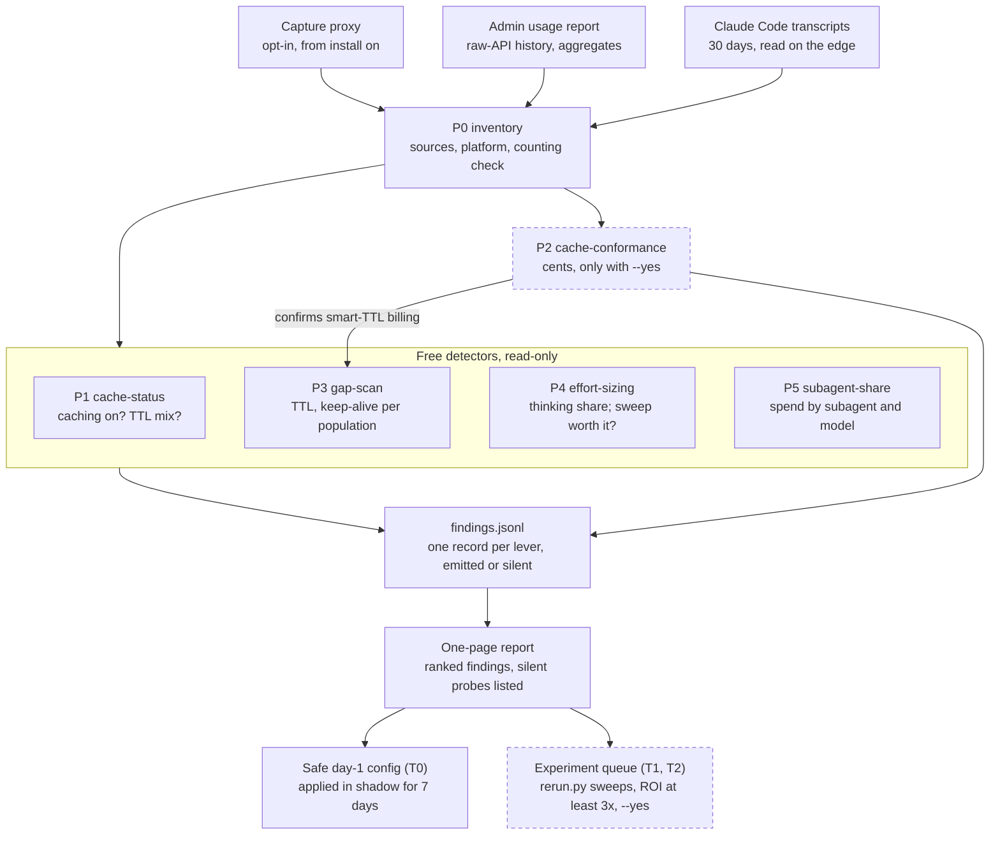

# OptHub onboarding scan: spec

**Status:** draft v0.1 · **Date:** 2026-10-24 · **Extends:** SPEC.md v0.4 §10 (`opthub detect`)

## Summary

`opthub onboard` runs once on day 0. It answers one question per customer: which of the savings in the defaults model are real here, and how big are they. It is `opthub detect` (SPEC §10) run over the last 30 days, plus one billing probe that spends cents and runs only with approval. Five probes read data the customer already has and spend nothing.

| Probe | Answers | Reads | Cost |
| --- | --- | --- | --- |
| P0 inventory | What data exists, for how many days, on which platform, through which gateway | Transcripts, Admin usage report, environment | Free |
| P1 cache-status | Is caching on, at which TTL, how much input is uncached | Usage fields per request, or the Admin usage report | Free |
| P2 cache-conformance | Does the 5-min-loop, 1-h-turn-end write bill as modeled on this platform; does the customer's gateway keep cache markers | Live synthetic requests | Cents, approval |
| P3 gap-scan | Which TTL and keep-alive policy fits each session population | Transcript timestamps and usage | Free |
| P4 effort-sizing | How much output is thinking per session class, and is a paid sweep worth it | `thinking_tokens` per request | Free; the sweep after onboarding is paid |
| P5 subagent-share | How much spend runs in subagents, on which model | Subagent transcripts | Free |

The customer gets back one findings record per lever and a one-page report. The report holds a safe day-1 config (T0 only, applied in shadow) and a ranked queue of T1 and T2 experiments, each clearing the §6.4 ROI gate.

## Flow



Dashed: spends money, and refuses to start without `--yes`. P0 decides which sources exist; the four free detectors then run in parallel. P2 runs only when no recent conformance result exists for the customer's platform, and its result decides whether P3 may count smart-TTL savings.

## Inputs and privacy

The scan follows SPEC §5.4: raw data stays on the machine that produced it, and only derived records travel. A Claude Code customer gets all six probes on day 0. A raw-API customer gets P0, P1 and P2 on day 0, and P3–P5 after about a week of capture, because the Admin usage report has no per-request gaps and no thinking tokens.

| Source | Used by | Access | Leaves the machine |
| --- | --- | --- | --- |
| Claude Code transcripts, `~/.claude/projects/**` including `subagents/**/*.jsonl` | P0, P1, P3, P4, P5 | Read on the edge; 30-day default retention, reported by P0 | Never. Only `opthub.session/1` and `opthub.finding/1` records travel |
| Admin usage report, `GET /v1/organizations/usage_report/messages` | P0, P1 for raw-API customers | Admin key, read-only, run by the customer; up to 31 daily buckets per page | Aggregates only: tokens by model, key, workspace, speed, geo, service tier |
| Capture proxy (SPEC §5.2) | P1–P5 from install on; the effort-switch check in P4 | Opt-in per project, redact-on-write | Never. Traces stay in `.opthub/cas/` |
| Live probe requests | P2 | OptHub's key in CI; the customer's key only for the path check | Synthetic prompts only, no customer content |

Rules every probe follows:

- **No text in findings.** Counts, tokens, dollars, flags and classes only; no prompt text, tool inputs or paths. `opthub onboard --dry` prints every field that would leave.
- **No spend without `--yes`.** P2 is the only probe that calls the API, and it refuses to start without `--yes`, like `tools/rerun.py`.
- **The Admin key is used once, locally.** OptHub never stores it; the report it fetched is reduced to a finding on the spot.

## Probes

Each probe is a detector in the SPEC §6.7 sense: it measures first and emits nothing when there is nothing to win. All of them price with one shared rate card and de-duplicate requests by message id, as `tools/sessiongraph.py` does. Every finding is proposed against the population it helps, never the portfolio aggregate (§6.6).

### P0 inventory (preflight)

- **Finds** each data source and its window, and the retention boundary (`tools/sessions.py` already reports it).
- **Detects the platform** from model IDs and the base URL: Anthropic API, Bedrock (`global.` vs `us.` and other geo prefixes, 1.1× on geo), Vertex, Foundry. A set `ANTHROPIC_BASE_URL` marks a gateway in path.
- **Counting check**: raw records vs requests de-duplicated by message id. Transcripts repeat usage once per content block, so a gap between the two means any tool that does not de-duplicate overstates spend.
- **Pins the rate card version** into every finding.
- **Stops the free probes** when fewer than 7 days or 20 sessions exist. The report then says "collect first" and only P2 runs.

### P1 cache-status (test 1)

- **Measures** per session, or per API key and day from the Admin report: uncached share = uncached ÷ (uncached + read + write); hit rate = read ÷ (read + write); TTL mix from the 5-minute and 1-hour write split.
- **Prices the counterfactual** (`priced`). In a session, each request within 5 minutes of the previous one has its prefix up to the previous request's input re-priced as a read, and the rest as a 5-minute write. From Admin aggregates, which have no sessions, the ceiling is uncached input × (1 − read multiplier) on keys with zero reads, labelled a ceiling.
- **Emits** `cache-enable` (T0) when more than 50% of input is uncached on sessions with at least two requests.
- **Silent** when the hit rate is at least 90%, following the cache-priming precedent (96.6% measured, SPEC §7).
- **Side lines** from the Admin report's `group_by`: fast-mode spend, US-only spend, batch share. Shown only when non-zero.

### P2 cache-conformance (test 2)

Two parts. Billing semantics are the platform's, not the customer's, so the expensive part runs once per platform and model family, not per customer.

- **(a) Smart-TTL conformance, in OptHub's CI on OptHub's key.** Onboarding reads the stored result. It runs the probe live, with approval, only when the customer's platform and model have no result from the last 30 days. About 8 minutes; cents.
    1. R1: a system prompt above the model's cache minimum, one user message, automatic caching at 5 minutes. Expect a 5-minute write.
    2. R2: R1 + its reply + a tool result. Expect a read of R1's prefix.
    3. Ping: R2 + its reply + a placeholder user message, `max_tokens: 0`, an explicit `ttl: "1h"` breakpoint on R2's reply. Pass if the 1-hour write covers only R2's reply and the read covers R2's prefix.
    4. Wait 7 minutes. R3: R2 + its reply + a new user message. Pass if at least 95% of the prefix through R2's reply is read from cache.
    5. Control: the same sequence without the ping. R3 must write, not read; otherwise the probe proves nothing.
- **(b) Path check, per customer, always.** Two `max_tokens: 0` requests through the customer's base URL. Pass if the second shows `cache_read_input_tokens` above 0. It catches gateways that strip cache markers.
- **Stores** `conformance/<platform>/<model>/smart-ttl.json` with the date and every usage block. Any model or pricing change expires it.
- **Until a pass exists** for the customer's platform, P3 reports smart-TTL numbers as `unconfirmed` and leaves them out of totals. On Bedrock the probe also settles whether automatic caching exists there; the docs conflict.

### P3 gap-scan (test 3)

- **Extends** `tools/savings.py` lever C, which already simulates a 5-minute TTL against real gaps.
- **Measures** per session: every gap between requests, the prefix at that point, whether the next request read or wrote, and the TTL used. A turn ends at an assistant record with `stop_reason: end_turn`.
- **Prices five policies** per session, cache-aware: current, 5 minutes everywhere, 1 hour everywhere, smart (5 minutes in the loop, 1 hour at turn end), smart plus keep-alive.
- **Keep-alive is decided by expected value.** From the customer's own gap distribution: ping while P(resume within the next 55 minutes, given idle so far) × rewrite cost > ping cost; stop otherwise.
- **Population rule**: results by the §2.4 write:read buckets and by pause profile; each proposal carries its predicate.
- **Stability** (§6.5): each policy's delta is signed on k = 5 sub-windows. One sign flip and it is not emitted; that is how §2.3's TTL result was caught.
- **Silent** when the best policy beats the current one by less than max(1% of window spend, $1).

### P4 effort-sizing (test 4)

- **Free part only.** Per session class (the J3/Jev classes): thinking share of output (`output_tokens_details.thinking_tokens`), output's share of cost, and the effort level where it is visible. Capture records `output_config.effort`; transcripts may not.
- **Ceiling** (`guess`): thinking dollars × the assumed cut, lever B's 50% in `tools/savings.py`.
- **Effort-switch check** (capture only): a top-level effort change mid-session followed by a cache write. The rewrite is priced and reported as pure loss.
- **Emits** an `effort-sweep` proposal only when ceiling × 30 days > 3 × the sweep's estimated cost (§6.4). The sweep runs after onboarding with `rerun.py --yes`: baseline against itself first, then low, medium and high, 3 repeats each, on the top sessions per class.
- **Silent** under the same max(1% of window spend, $1) floor.

### P5 subagent-share (test 5)

- **Measures** spend by thread: main vs subagent (sidechain records and `subagents/**/*.jsonl`, read as `tools/sessiongraph.py` reads them), by subagent type and model, with each subagent's tool mix. Read-only tools mark a candidate.
- **Ceiling** (`priced`): candidate subagent spend re-priced at Haiku 5.5 with a 1.5× token penalty (`guess`). Requests above 100K prompt tokens are priced at Haiku's 5× tier and flagged.
- **Emits** a T2 `model-routing` proposal; per SPEC §7 a T2 change is always proposed, never auto-applied.
- **Silent** when the candidates already run on Haiku, or their share is under the floor.

## Output

Every probe writes findings records, emitted or silent, to `data/private/onboard/<date>/findings.jsonl`. The report is rendered from those records alone. The record extends the `opthub.session/1` conventions of SPEC §5.4: no text, an input hash, and an idempotency key.

```yaml
schema: opthub.finding/1
probe: gap-scan                      # P0–P5
lever: cache-config                  # SPEC §7 optimizer id
tier: T0                             # T0 | T1 | T2
population:
  predicate: "<write:read bucket and pause profile>"
  sessions: <n>
  spend_usd: <list-price spend of the population>
window: { start, end, days, input_hash: "sha256 of the trace set" }
ratecard: "<version>"
current_usd: <cost as run>
counterfactual: { policy: "<name>", usd: <cost under the policy> }
delta: { usd, pct_of_window }        # marginal, in applied order (SPEC R1)
label: priced | measured | guess | detector
stability: { k: 5, sign_flips: <n> }
depends_on: ["conformance/<platform>/<model>/smart-ttl"]
status: emit | silent | unconfirmed
next: apply-shadow | run-sweep | run-probe | none
```

The report is one page, in this order:

1. **Window and data**: days, sessions, list-price spend, sources, retention boundary, rate card version.
2. **Findings**, ranked by delta, marginal in applied order, each with its label and population.
3. **Safe day-1 config**: T0 findings only, applied in shadow for 7 days. Shadow logs what would change and changes nothing (SPEC §16 rule 1).
4. **Experiment queue**: T1 and T2 proposals, each with estimated verification spend and projected 30-day saving at or above 3×.
5. **Silent probes**, listed with the reason, for example "cache hit 97%: nothing to win". A silent probe is a result, not an omission.

## Acceptance criteria

A probe ships when it reproduces a number the repo already pins, and stays silent on a fixture built to have nothing to win.

| Probe | Correct when | Silent-case fixture |
| --- | --- | --- |
| All | Same input hash gives byte-identical findings. No prompt text, tool input or path in any output: a test greps for strings planted in the fixture. Requests de-duplicated by message id. 30 days of transcripts scanned in under 5 minutes on a laptop (target) | — |
| P0 | Retention boundary and session count match `tools/sessions.py`; the raw vs de-duplicated gap is reported | A 3-day transcript set: report says "collect first" |
| P1 | Shares match a synthetic transcript with known cached and uncached tokens exactly; the Admin-report ceiling matches a hand calculation | A session set at 97% hit rate: emits nothing |
| P2 | Passes on the Anthropic API for Opus 5.5 and Sonnet 5.5 before any onboarding quotes smart-TTL numbers; the control arm shows the miss | A gateway fixture that strips `cache_control`: the path check fails and says so |
| P3 | On the transcripts behind `docs/data/e1b-sessions.csv`, reproduces SPEC §2.4's 5-minute deltas: +$12.75 for write:read > 2.0, −$8.56 for < 0.5, net +$11.05 | A window where the policy's sign flips across sub-windows: not emitted |
| P4 | On the same window, reproduces lever B's $13.72 (2.7%) from SPEC §7 | Thinking under the floor in every class: emits nothing |
| P5 | Main plus subagent spend ties to the session total within 0.1% | All subagents already on Haiku: emits nothing |

## Build plan

Two fixes come before any probe, because every number the probes print depends on them. Six tools (`sessions.py`, `savings.py`, `loopscan.py`, `lenops.py`, `ctxwatch.py`, `costmodel.py`) price every cache read at 0.1× input. That is 2× the real rate on Opus 5.5 and Sonnet 5.5, and 4× on Fable 5.1. And only `sessiongraph.py` de-duplicates requests by message id.

Work on a branch, one commit per step. Stop after step 2 for review.

1. **`tools/ratecard.py` (new).** One rate card, version-stamped, imported by every tool in place of the per-file price tables. It carries per-model cache-read multipliers (0.05× Opus and Sonnet 5.5, 0.025× Fable and Mythos 5.1, 0.1× others), Haiku 5.5's 100K tier, and Bedrock's 1.1× geo multiplier.
2. **De-duplicate by message id** in `sessions.py`, `savings.py`, `loopscan.py`, `lenops.py` and `rerun.py measure()`, using `sessiongraph.py`'s rule. Then compare totals on one session and on the E1b window. **Stop here and review the diff and both totals:** if they differ, the E1 and E1b ledgers are overstated, and PROGRESS.md gets an entry before anything is built on top.
3. **`tools/probe_cache.py` (new, P2).** It spends cents and refuses to start without `--yes`. Do not run it while building; print the plan and the estimated cost. Run it first once built, on OptHub's key: it decides whether the largest Claude Code saving in the defaults model is real.
4. **`tools/gapscan.py` (new, P3)**, built from `savings.py` lever C. It must reproduce SPEC §2.4 on the E1b window before any new policy is added.
5. **`tools/cachestatus.py` (new, P1)**, reading transcripts or an Admin usage report JSON export.
6. **P5**: extend `sessiongraph.py` with a spend split by thread and subagent model.
7. **P4**: extend `savings.py` lever B to report per session class, plus the capture-only effort-switch check. It must reproduce $13.72 (2.7%).
8. **`tools/onboard.py` (new).** Runs P0–P5 in order, writes the findings and `report.html`, and becomes `opthub onboard` (an alias of `opthub detect --profile onboarding`) in SPEC §10.

Each probe gets a synthetic fixture with a known answer, plus a silent-case fixture, as in the acceptance table. Stdlib only, per CLAUDE.md.

The public `main` branch (last commit 18 Oct) has no `levers/` directory and no `tools/bigreads.py`, which the big-read-offload dossier cites. Push those first so the probes build on the same tree.

## Sources

- The defaults savings model (internal doc, "Claude cost knobs: savings for a default-config customer", and its script `defaults_savings_model.py`, not in this repo): the five tests this spec turns into probes.
- [SPEC.md v0.4](../SPEC.md): §2.3–2.4 TTL sign flips by write:read bucket, §5.2 capture, §5.4 derived session record, §6.4–6.7 gates and detector rule, §7 catalog and lever B, §10 `opthub detect`, §16 shadow first.
- [CLAUDE.md](../CLAUDE.md): rules for numbers and privacy.
- [tools/](../tools): `sessions.py`, `savings.py` (levers B and C), `sessiongraph.py` (de-duplication, subagents), `rerun.py` (the paid sweep); read at commit f897388, 18 Oct 2026.
- [Get Messages Usage Report](https://platform.claude.com/docs/en/api/admin/usage_report/retrieve_messages): Admin API fields and grouping for P0 and P1.
- [Prompt caching](https://platform.claude.com/docs/en/build-with-claude/prompt-caching): TTL rules, mixed-TTL billing positions, `max_tokens: 0` pre-warming, minimum cacheable length.
- [Effort](https://platform.claude.com/docs/en/build-with-claude/effort): per-message effort and why top-level changes rewrite the cache.
