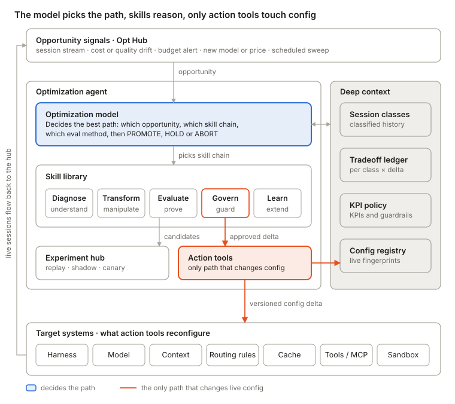
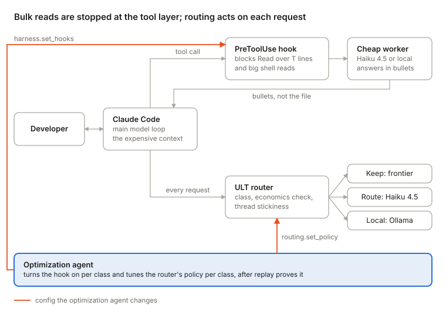
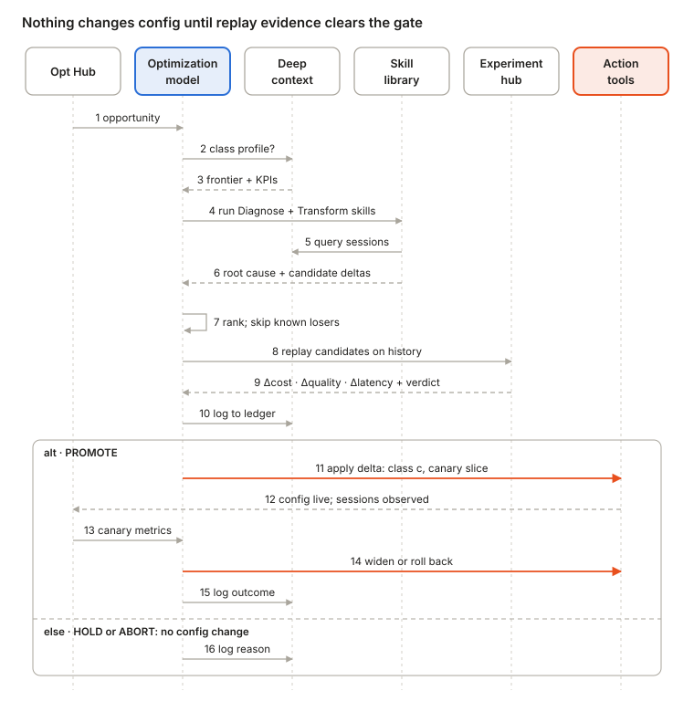

# [O] Optimization agent — models, skills, actions

*Design spec, draft · 2026-10-29, updated 2026-10-31 (two skills in depth; bulk-read implemented) · owner oleg@canarian.io. Nothing here is measured yet; claims carry
an epistemic label. Related: `SPEC.md` §6 (the safety gate) and §16 (epic RO),
[`optimizers.md`](optimizers.md) (the levers), [`router-comparison.md`](router-comparison.md),
[`runtime-optimization.md`](runtime-optimization.md).*

## Purpose and terminology

The [O] agent searches, per session class, for the cheapest configuration that still meets that class's KPIs, and changes live config only through versioned, reversible action tools. Three layers do the work; one memory layer feeds them.

| Term | What it is | What it decides or produces | Touches live config? | Example |
| --- | --- | --- | --- | --- |
| Optimization model | The decision layer: picks the best path for an opportunity | Which opportunity first, which skill chain, which eval method, then PROMOTE / HOLD / ABORT | No | "Class *feature · Claude Code* carries unused tool schemas: run schema-pruner, replay a sample first" |
| Skill | Packaged know-how: a manipulation that could be done, or a way to understand or extend the optimization choice | Findings, candidate config deltas, verdicts, ledger rows | No (dry-run only) | schema-pruner, cost-decomposer, historical-replay |
| Action / tool | Executable that changes the config of an involved system: agent harness, model, context, routing rules, cache, tools/MCP, sandbox | Applies, verifies and rolls back one config delta | Yes, and nothing else does | `mcp.set_allowlist(class, servers)` |
| Deep context | Memory the model reasons over: historical session classification, tradeoff ledger, KPI policy, config registry | What has been tried, what won, what is allowed | No | "Cascade on class *review* was ABORTed in Sep: quality floor broken" |
| Config delta | The unit of change: a diff over a config fingerprint, scoped to one session class and a traffic slice | Carried from skill to action tool | Only when applied | `{class: c, slice: canary, mcp.disable: [jira, figma]}` |

Four design rules hold everywhere:

- **Skills never write config; only action tools do.** Every live change is one auditable, reversible delta.
- **Every decision is per session class, never global.** A win on one class proves nothing about another.
- **No promote without ledger evidence.** Losses are recorded too, so the model never retries a known loser.
- **Every delta has a rollback and an expiry.** Model, price or harness releases trigger revalidation.

## High-level architecture



Signals queue opportunities for the optimization model, which reads deep context, picks a skill chain and sends candidates to the Experiment hub. Only a Govern-approved delta reaches the action tools; the reconfigured systems produce live sessions that flow back to the hub.

## Skill taxonomy

Skills fall into five categories that follow one optimization cycle: understand the waste, propose a change, prove it, apply it safely, and learn from the result. Only Govern skills may call action tools.

| Category | Term | Question it answers | Output | Calls action tools? |
| --- | --- | --- | --- | --- |
| **Diagnose** | understand | Where is the waste in this class, and why? | Finding + root cause, sized by class volume | No |
| **Transform** | manipulate | What change could remove it? | Candidate config deltas | No (dry-run only) |
| **Evaluate** | understand (prove) | Is the candidate better on this class, within KPIs? | Δcost, Δquality, Δlatency + PROMOTE / HOLD / ABORT | Replay: no. Shadow or canary: only through Govern |
| **Govern** | apply safely | Is it allowed, and how do we roll it out and back? | Approved, scoped delta + rollback trigger | **Yes, the only category that does** |
| **Learn** | extend | What did we learn, and is a past win still true? | Ledger rows, refined classes, new candidate knobs | No (writes deep context only) |

### Skill catalog

Transform skills are grouped by the lever they pull; a lever maps to the target system an action tool changes.

| Skill | Category | Lever | What it does |
| --- | --- | --- | --- |
| session-classifier | Diagnose | — | Assigns each session to a class on the schema axes in *Deep context* |
| cost-decomposer | Diagnose | all | Splits class spend into users × sessions × turns × requests × tokens × price and names the factor driving it |
| schema-tax-detector | Diagnose | context, tools | Measures tool-schema tokens loaded per request against tools actually called |
| cache-miss-analyzer | Diagnose | cache | Finds unstable prompt prefixes and TTL expiries that break prompt caching |
| model-fit-analyzer | Diagnose | model | Flags classes whose outcomes show no gain from a higher model tier in history |
| loop-detector | Diagnose | harness | Finds repeated tool calls, runaway turns and failed retries |
| drift-detector | Diagnose | all | Flags a class whose cost per successful task moved since its last proven config |
| model-downshift / cascade | Transform | model, routing | Cheaper model per step, or cheap-first with escalation on a failure signal |
| reasoning-budget-tuner | Transform | model | Lowers thinking budget, effort or max output tokens per class |
| route-rule-writer | Transform | routing | Writes per-class route rules for the gateway |
| schema-pruner | Transform | context, tools | Drops never-called MCP servers or tools; loads schemas on demand |
| prefix-stabilizer | Transform | cache, context | Reorders the prompt so the static prefix caches; sets breakpoints and TTL |
| compaction-policy | Transform | context | Sets when and how context compacts. Guarded: compaction can raise cost by rewriting cached prefixes *(validated fact, project ledger)* |
| turn-cap / loop-breaker | Transform | harness | Caps turns and tool calls; adds stop conditions |
| cheap-worker-delegation | Transform | harness | Hands sub-steps to a cheaper worker; bulk-read delegation is its first, implemented form (below) |
| code-mode | Transform | harness, tools | Replaces a chain of tool calls with one generated script |
| batch-scheduler | Transform | sandbox, runtime | Moves non-interactive classes to batch or off-peak pricing |
| historical-replay | Evaluate | — | Reruns sampled sessions of the class with the candidate config in a sandbox |
| partial-replay | Evaluate | — | Replays from step N to test a single-step change |
| shadow-run | Evaluate | — | Mirrors live requests to the candidate without returning its results |
| quality-judge | Evaluate | — | Scores outcomes: tests pass, PR merged, task accepted; LLM judge only as tiebreak |
| stat-gate | Evaluate | — | Paired comparison with a confidence bound → PROMOTE / HOLD / ABORT |
| policy-check | Govern | — | Checks KPI floors, frozen classes, budget and approval rules |
| rollout-planner | Govern | — | Canary slice first, then widen; sets the rollback trigger |
| rollback | Govern | — | Reverts to the previous config fingerprint when the trigger fires |
| ledger-writer | Learn | — | Records every result, losses included, with an expiry |
| class-refiner | Learn | — | Splits a class when one delta's outcomes diverge inside it |
| knob-scout | Learn | — | Turns a new model, price or harness feature into new candidate deltas |
| revalidator | Learn | — | Re-runs past wins on fresh sessions on drift or expiry |

### Skill manifest

Every skill ships a manifest the optimization model reads to decide whether it applies and what evidence it needs.

```yaml
skill: schema-pruner
category: transform            # diagnose | transform | evaluate | govern | learn
lever: [context, tools]
applies_when:
  finding: schema_tax          # emitted by schema-tax-detector
  harness_supports: [mcp_allowlist]
inputs:
  - deep_context.session_classes[c].tool_usage
  - deep_context.config_registry[c].mcp_servers
produces:
  candidate_deltas:
    - op: mcp.disable_servers  # servers never called in class c
    - op: tools.lazy_load_schemas
risk: low                      # reversible, no model change
requires_eval: [historical-replay, quality-judge, stat-gate]
action_tools: [mcp.set_allowlist, harness.set_tool_loading]  # called by Govern, never by this skill
ledger_keys: [class, baseline_fp, delta, d_cost, d_quality, d_latency, n, method, verdict, expires]
```

## Two skills in depth



Both act during the session but at different layers: bulk-read delegation stops a large file at the tool call, before it enters the context; routing decides which model answers each request. The agent changes neither in flight: it sets the hook and the router policy per class, after replay.

### Bulk-read delegation (the Spotify pattern) — implemented

Bulk-read delegation keeps large files out of the expensive model's context. A hook stops big file reads during the session and sends the file to a cheap worker model, which returns a short answer. It pays only for files that would otherwise stay in context for many requests, and only where the agent will not edit that file next.

**Where it comes from.** Spotify's `shunt` plugin for Claude Code, published by Dimitri Mazmanov in September 2026, works in three layers ([Techzine](https://www.techzine.eu/news/devops/144093/spotify-reduces-claude-code-token-usage-by-90-percent/)): PreToolUse hooks block any `Read` over 350 lines and shell reads (`cat`, `head`, `tail`) of large files, while targeted reads with an offset or limit pass; the block message redirects the model to a bulk-reader skill; that skill runs on a cheap worker model (Gemini 2.5 Flash), so the file never enters Claude's context. Spotify reports about 90% fewer Claude tokens on four bulk-read scenarios in a Java monorepo — read-context tokens in those scenarios, not the bill, with the worker's tokens extra *(self-reported, 4 scenarios)*. Its stated limits: no delegated edits (summaries lack reliable line numbers), no delegated reasoning (the worker missed a thread-safety bug), and 10–30 s per delegation.

**Why it saves in Claude Code.** A file read into the main thread is written to the cache, then re-sent with every later request as a cache read until compaction. On Opus 5.5 the write costs 2× input at the 1-hour TTL and each read 0.05× (`tools/ratecard.py`), so 40 later requests cost as much as the write. In the pinned month, cache reads were 48% and cache writes 34% of spend (the `read$` and `write$` columns of `docs/data/e1b-sessions.csv`): caching makes a file cheaper per request, not free.

```math
\text{saving per read} \approx T_{\text{file}}\,(p_{w} + R_{\text{after}}\,p_{r}) - T_{\text{answer}}\,(p_{w} + R_{\text{after}}\,p_{r}) - C_{\text{worker}}
```

T is tokens, R_after the requests left on that thread before compaction, p_w and p_r the cache write and read prices, C_worker the worker's cost. Latency is a separate cost on interactive sessions. Delegation does not pay for small files, files read late, reads inside subagents, or context about to be compacted.

**Delegation is not a model switch.** The worker is a separate one-off call with its own short context. The main thread keeps its model and its cache; only the tool result changes, from the file to a short answer, so nothing in the main thread's cache is broken. Switching the main thread itself to a cheaper model would break it, which is why routing works per thread (next section). The main model can still pull exact lines through targeted reads and searches, which the hook lets through.

**Where to enforce it.** This is a tool-result optimization; the enforcement point depends on which tool returns the large output.

| Large output from | Passes an MCP gateway? | Enforce with |
| --- | --- | --- |
| Built-in `Read`, shell `cat`, `Grep` | No; runs inside the harness | `harness.set_hooks` (PreToolUse block) — what opthub implements |
| MCP tools (GitHub file fetch, Jira or Confluence pages, database queries, logs) | Yes | `mcp.set_result_policy(server, tool, max_tokens, mode: truncate \| handle \| summarize)` at the gateway, or a PostToolUse hook that replaces the MCP output |
| `WebFetch` | No | Already answered by a small model inside Claude Code, as far as known |

At a gateway, prefer *handle* over *summarize*: the gateway does not know what the agent wants. Claude Code already refuses MCP outputs over 25,000 tokens by default (`MAX_MCP_OUTPUT_TOKENS`, [source](https://help.xpoz.ai/en/articles/12681842-claude-code-mcp-tool-exceeds-maximum-allowed-tokens-25000)) — a cap, not a summarizer.

**Implemented in opthub** (2026-10-31; tested offline, not yet run against a live Claude Code session):

| Piece | Where | What it does |
| --- | --- | --- |
| Diagnose: `large-read-detector` | `tools/readscan.py` (tests: `tools/test_readscan.py`) | From transcripts: every whole read over the threshold, its carry until compaction, main thread or subagent, edited or re-read afterwards, priced in context vs delegated. Free; paths hashed unless `--show-paths` |
| Transform + action: the hook | `app/hooks/bulk-read/gate.mjs` | PreToolUse on `Read\|Bash`. Blocks whole reads over `BULK_READ_THRESHOLD` (350) and plain `cat\|less\|more\|nl\|bat`; passes targeted reads, small files, binaries, files edited in the session, files the worker failed on, and the second whole read of a blocked file. Errors never block |
| The worker | `app/hooks/bulk-read/bulk-read.mjs` | `bulk-read --question "<q>" <file>…`: numbered lines to a cheap model, cited bullets back. `api` mode through a proxy route alias (E2B), `claude` mode via `claude -p` (local sandbox) |
| Evaluate: the experiment | `bulk-read-delegation` in `app/config/optimizations.json`; `claude.bulkRead` in `app/lib/arm-config.mjs` | Baseline vs arm on a real session, judged blind. Both runners (`optimize.mjs`, `core.mjs`) add the worker's logged cost to the arm, since it is spent outside Claude Code's accounting, and report blocks, overrides and worker latency |
| Tests | `app/test/bulk-read.test.mjs` (in `npm test`) | Gate decisions, the hook as a process, the worker against a mock API and a fake `claude`, the wiring in both runners |

```sh
python3 tools/readscan.py --days 30          # free: is there anything to save here?
opt optimize bulk-read-delegation            # spends: one task, baseline vs the hook, local sandbox
node app/optimize.mjs <sessionId> --experiment=bulk-read-delegation   # spends: E2B, worker on qwen30
```

The E2B worker is open-weights (`qwen30`) and the local one Haiku 4.5, so results from the two sandboxes are not comparable to each other.

```yaml
skill: bulk-read-delegation
category: transform
lever: [harness, context]
applies_when:
  finding: large_read_carry      # tools/readscan.py
  class_tool_style: reader
  harness_supports: [pretooluse_hooks]
exclude_classes: [coding/debug, review/security]
produces:
  candidate_deltas:
    - op: harness.hook_large_read
      sweep: {threshold_lines: [200, 350, 800]}
    - op: harness.hook_bash_read
    - op: worker.route
      targets: [remote:claude-haiku-4-5, local:ollama]
risk: medium                     # summaries can miss what an edit needs
requires_eval: [historical-replay, quality-judge, stat-gate]
measures: [main_tokens, worker_tokens, total_cost, added_latency, bash_leak_rate, reread_rate]
action_tools: [harness.set_hooks, harness.set_skill, routing.set_rule]
```

**Red team.** The hook is commodity: third parties reproduced the pattern within about 72 hours of publication; what is not commodity is the fire rate, threshold and class gating measured on one customer's sessions. Leaks make it theatre: if shell reads or re-reads after a summary are common, the gate saves little — the run's override count and `readscan.py`'s re-read count measure that. And a summary can miss what matters, so reasoning classes stay excluded and outcomes are judged blind.

### Model routing

Model routing sends work that does not need the frontier model to a cheaper one. In Claude Code the unit must be a whole class or a thread, never a single turn: switching models mid-thread re-buys the cached prefix at the write price, which usually costs more than it saves. The agent does not route requests itself; it tunes the router's policy per class and proves each change by replay.

| Layer | What it decides | Where in opthub | Who changes it |
| --- | --- | --- | --- |
| Static, per class | The model a class launches on, the subagent model, the effort level | Claude Code settings: `--model`, `CLAUDE_CODE_SUBAGENT_MODEL`, effort (the J3 methods, applied by `recommend.py`); catalog entries `route-*` and `litellm-route-side-calls` | The optimization agent, offline |
| Dynamic, per request | Keep, route or local, for each request | ULT, the router inside `opt claude optimize` (`docs/runtime-optimization.md`) | The router at runtime; the agent tunes its config |

ULT already has the safety parts this skill relies on: a never-downgrade list (`coding/debug`, `review/security`), a cache-aware economics check, thread stickiness, shadow mode, a per-model adapter with fallback, and a hash-chained audit log. Its own conclusion: without scoped context, real savings come from background calls answered locally and from threads that start small, such as subagents.

**The objective is cost per successful task, not price per token.** A model cheaper per token can cost more per task. ULT's one live route answered a summary on Haiku 4.5 for about a quarter of the Opus price and added a detail not in the source (`docs/runtime-optimization.md` §8, n = 1).

| Category | Skill | What it does |
| --- | --- | --- |
| Diagnose | model-fit-analyzer | Per class: outcomes by model in history (J3 capability labels, replay grades), subagent share of spend (`sessiongraph.py`), share of background calls |
| Diagnose | routing-audit-reader | Reads ULT's shadow-mode audit: what it would have routed, the estimated saving, economics-check vetoes, fallbacks |
| Transform | route-tuner | Patches ULT's policy per class (routes, never-downgrade list, minimum confidence, local on or off) and static deltas (launch model, subagent model, effort) |
| Transform | cascade | Cheap model first, escalate on a failure signal such as a failing test; only for threads that start small |
| Evaluate | historical-replay, shadow week, quality-judge | Replays routed threads on the target model, blind-graded; J3 already queues `route-cheaper-frontier` re-runs |
| Govern | policy-check, rollout-planner | Shadow first, then route mode on a canary slice of one class |
| Learn | ledger-writer, knob-scout | A row per class and target model; a new model or price reopens closed rows |

Candidate deltas, safest first *(reasonable inference; each still needs its replay)*: (1) subagent model to Haiku — subagent threads start small, so no cached prefix is re-bought (`litellm-route-side-calls` already measures the Sonnet version); (2) background calls to a local model; (3) non-coding classes to Haiku, thread-sticky; (4) lower effort for a class; (5) a whole class on a mid-tier model — J3 prices "every session mid-tier" at 59.5% of spend, a priced ceiling (`experiments/session-triage/data/RESULTS.md`); (6) mid-thread routing of coding turns, not until scoped context (C3) lands.

Action tools: `routing.set_policy(project, patch)` writes the project layer `<project>/.opthub/ult.json`; `routing.set_mode(shadow | route)`; `model.set(class, model, effort)` writes `.claude/settings.local.json` through `recommend.py`'s `apply.sh`. Rollback reverts the file; `--pin frontier` overrides everything for a session.

**Red team.** The router is commodity (intent routing ships free in LiteLLM and vLLM Semantic Router), and routing was one of six big levers at Uber *(project evidence ledger)*: the value is the per-class proof, not the router. Cache economics can make routing net-negative on main threads. Public routing results (RouteLLM) are chat benchmarks, not agentic sessions. Cheapest test: the shadow-mode week ULT is built for — sum the savings the economics check would approve, by class.

## Optimization models

The optimization model solves one problem per session class: find the cheapest config that still meets that class's KPIs, spending as little on evaluation as possible.

```math
\delta^{*}_{c} = \arg\min_{\delta \in \Delta_{c}} \; \mathbb{E}\left[\text{cost per successful task} \mid c, \delta\right] \quad \text{s.t.} \quad Q_{c}(\delta) \ge Q_{c}^{\min}, \;\; L^{p95}_{c}(\delta) \le L_{c}^{\text{SLO}}, \;\; \text{risk}(\delta) \le r_{c}
```

Opportunities are queued by expected value, so eval spend goes where it can pay back:

```math
EV(o) = \Delta C_{c} \times V_{c} \times P(\text{promote}) - C_{\text{eval}}
```

ΔC is the saving per session, V the class volume, P(promote) is read from the ledger (prior outcomes of similar deltas), and C_eval is the replay or canary cost.

### The four decisions it makes

| Decision | Reads from deep context | Output |
| --- | --- | --- |
| Which opportunity first | Class volume, cost decomposition, ledger rows already tried | Ranked opportunity queue |
| Which skill chain | Finding type, skill manifests, harness capabilities | Ordered chain: Diagnose → Transform → Evaluate |
| Which eval method | Risk tier, whether the class is replayable, eval budget | Escalation: replay → shadow → canary |
| PROMOTE, HOLD or ABORT | Stat-gate verdict, KPI policy, frozen classes | Delta handed to Govern, or a ledger row only |

### Model types, layered

| Model type | Role | Use when | Status |
| --- | --- | --- | --- |
| Policy rules | Hard guardrails: KPI floors, frozen classes, approval thresholds | Always, evaluated first | Build now |
| Cost model | Sizes opportunities with the cost decomposition | Always | Build now |
| LLM planner | Composes skill chains for new findings; writes the rationale stored with each delta | Novel opportunities; every explanation | Build now, bounded by policy rules |
| Statistical gate | Turns paired results into PROMOTE / HOLD / ABORT | Every Evaluate step | Build now |
| Bandit / Bayesian optimizer | Chooses among already-proven candidates per class while still exploring | High-volume classes with a stable outcome signal | Later. Volume per class at design partners is *unknown* |

The LLM planner proposes; the policy rules and statistical gate dispose. No path lets the planner reach an action tool without a gate verdict *(design decision, not yet tested)*.

## Actions and tools

Action tools are the only code that writes config. Each takes one scoped config delta and implements the same four calls, so Govern can treat every target system alike.

```python
class ActionTool:
    def dry_run(self, delta, scope) -> Diff: ...          # what would change, nothing applied
    def apply(self, delta, scope) -> Fingerprint: ...     # scope = {class, traffic_slice}
    def verify(self, fp) -> bool: ...                     # config really live as intended
    def rollback(self, to_fp) -> Fingerprint: ...         # back to the previous fingerprint
```

| Target system | Example action tools | What changes | Control point needed | Reversal |
| --- | --- | --- | --- | --- |
| Agent harness | `harness.set_limits`, `harness.set_subagent`, `harness.set_hooks` | Turn caps, sub-agent model, hooks, instruction files | Harness config at the endpoint (settings, hooks) | File revert |
| Model | `model.set(class, model, effort, max_tokens)` | Model id, reasoning budget, output cap | Gateway or harness config | Instant |
| Context | `context.set_compaction`, `context.set_layout` | Compaction policy, prompt order, retrieval | Harness tier: the wire proxy cannot see the whole context payload *(validated fact, project ledger)* | File revert |
| Routing rules | `routing.set_rule`, `routing.set_cascade` | Per-class routes, cascade thresholds | Gateway; substrate still open (LiteLLM callbacks vs Envoy ext_proc) | Instant |
| Cache | `cache.set_breakpoints`, `cache.set_ttl` | Cache points, TTL, semantic cache | Gateway + prompt layout | Instant; cache warms again |
| Tools / MCP | `mcp.set_allowlist`, `harness.set_tool_loading` | Which servers and tools load; lazy schemas | MCP gateway or harness config | Instant |
| Sandbox / runtime | `runtime.set_pool`, `runtime.schedule` | Warm pools, timeouts, batch vs live | Orchestrator | Next session |
| Budget | `budget.set_cap(class)` | Spend caps for machine-run classes only | Gateway | Instant |

Two boundaries are deliberate. Budget caps apply to machine-run classes only: three data points argue against hard caps on human spend *(validated fact, project ledger)*. And every delta is scoped to one class and a traffic slice, stored as a commit in a config repo so it can be reviewed, diffed and reverted like any GitOps change *(proposal)*.

## Deep context: tradeoffs and session history

Deep context is the part competitors cannot copy from a blog post: classified session history plus a tradeoff ledger let the model skip known losers and reuse proven wins, per class and per customer. It keys on session class and config fingerprint, not on a ticket join key, so [O] does not wait on K1 *(reasonable inference, consistent with the Databricks benchmark evidence)*.

### Historical session classification

Every recorded session is classified on these axes; a session class is a stable combination of them.

| Axis | Example values | Used for |
| --- | --- | --- |
| Workload | Coding agent, dedicated agent, agentic loop, third-party agent, pipeline | Which skills apply |
| Harness | Claude Code, Cursor, custom LangGraph agent | Which action tools can reach it |
| Task class | Bugfix, feature, refactor, review, triage, Q&A | Grouping comparable sessions |
| Step type | Plan, search, edit, test, summarize | Optimizing one step, not the whole workload |
| Complexity band | Derived from task signals, not human estimates | Eval sampling. Human-rated difficulty tracks token cost only at τ≈0.32 *(validated fact, Bai et al. 2026)* |
| Token profile | Input vs output share, cache-read ratio, schema tokens | Which lever to pull |
| Shape | Turns, tool calls, sub-agents, retries | Harness levers |
| Outcome | Tests pass, PR merged, accepted, escalated, abandoned | The quality signal |
| Cost and latency | Per session and per successful task | The objective |
| Config fingerprint | Hash of model + harness + tools + routing + cache | Ties every outcome to the config that produced it |
| Owner (optional) | Team, repo, ticket | [V] attribution; not required by [O] |

### Tradeoff ledger

One row per (class, baseline fingerprint, candidate delta) result. The per-class Pareto frontier over cost, quality and latency is computed from these rows; the KPI policy picks the point on it.

| Field | Meaning |
| --- | --- |
| class | The session class the result holds for |
| baseline_fp → delta | What was changed, from which config |
| Δcost per successful task | Primary objective |
| Δquality, Δlatency p95 | Constraints checked against the KPI policy |
| n, interval | Sample size and confidence bound |
| method | Replay, partial replay, shadow, canary or live |
| verdict | PROMOTE, HOLD or ABORT, with the reason |
| evidence | Experiment and session ids |
| expires / revalidate_on | Date, or a drift or release trigger |
| rollbacks | Count and reasons after promotion |

Three rules keep the ledger honest:

- **Losses are first-class.** An ABORT row stops the model retrying the same delta on the same class until the row expires.
- **A win holds only for its class and fingerprint.** A model, price or harness release expires the rows that depend on it.
- **HOLD carries its blocker.** "Harness can't lazy-load schemas" is a ledger row, and a signal for knob-scout when the harness changes.

## Sequence flow



One cycle runs per opportunity and class. Solid arrows are calls, dashed are returns; only steps 11 and 14 change live config.

1. **Context (1–3).** The Opt Hub hands the model an opportunity for class *c*. The model pulls the class profile, its tradeoff frontier, KPI policy and any ledger rows for similar deltas.
2. **Diagnose and plan (4–7).** Diagnose skills read the class's sessions and return a root cause; Transform skills turn it into candidate deltas. The model ranks them and drops any delta the ledger already ABORTed for this class.
3. **Evaluate (8–10).** The Experiment hub replays the candidates on historical sessions; stat-gate returns deltas and a verdict. The result is logged whatever it is.
4. **Promote (11–15).** Govern applies the delta to a canary slice of class *c*. The hub observes live sessions, the model widens or rolls back, and the outcome goes to the ledger.
5. **Hold or abort (16).** No config changes; the reason and a revisit trigger go to the ledger.

## Worked example: MCP schema tax on coding sessions

This is KT-9 run as a full skill chain instead of a one-off audit. MCP schema removal was among Uber's largest levers *(validated fact, project ledger EV-2026-08-27)*; whether it is large at a design partner is *unknown* until KT-9 runs. No numbers below are measured.

1. **Trigger.** cost-decomposer shows tokens per request dominate class *feature · Claude Code*; schema-tax-detector fires.
2. **Context.** The model reads deep context: no ledger row for schema pruning on this class; KPI policy says the tests-pass rate must not drop and p95 latency must hold.
3. **Diagnose.** schema-tax-detector lists MCP servers loaded in every session of the class but never called.
4. **Transform.** schema-pruner proposes two deltas: (a) disable the never-called servers, (b) lazy-load all tool schemas.
5. **Plan.** The model ranks (a) first: low risk, harness supports an allowlist. (b) needs `harness.set_tool_loading`, which this harness may not expose.
6. **Evaluate.** historical-replay reruns a sample of class sessions with (a); quality-judge scores outcomes; stat-gate returns a verdict.
7. **Govern.** On PROMOTE, policy-check passes and rollout-planner applies (a) to a canary slice through `mcp.set_allowlist`, with rollback on any tests-pass drop.
8. **Learn.** ledger-writer records (a) with its interval and expiry, and records (b) as HOLD: "blocked by control point". knob-scout re-raises (b) when the harness changes.

## Red team: crux and kill tests

The skills are not the moat; the per-customer ledger and replay harness might be. Whether replay evidence predicts live results cheaply enough is the load-bearing unknown.

**Steelman.** Skills encode the public playbook, but the ledger and replay harness are per customer and compound: each cycle makes the next one cheaper and safer for that class. That matches Spot's levers — continuous automation, a scary risk (quality regression) abstracted away, savings shown as a counterfactual *(founder belief)*.

**Attacks.**

- **Skills are commodity.** LiteLLM's free tier ships auto-routing, caching and savings benchmarks; the shunt pattern was reproduced by third parties within 72 hours; TensorZero was archived after selling the optimization loop itself *(validated facts, project ledger, Jun–Sep 2026; not re-checked today)*.
- **Replay may be too noisy.** The same agentic task swings up to 30× in tokens across runs *(validated fact, Bai et al. 2026)*. If run-to-run noise exceeds a delta's effect, proving it per class needs samples whose replay cost eats the savings *(unknown)*.
- **The control point may be out of reach.** Most Transform skills need harness-tier knobs (tool registry, skills, context); the spawn-time shim reaches only the wire *(validated fact, project ledger)*. What closed harnesses expose is *unknown* per harness.
- **Classes may drift faster than they pay back.** If ledger rows expire before the saving accrues, the agent is all eval cost *(unknown)*.
- **One bad automated change costs more trust than many good ones earn.** Govern must be conservative, which slows time to savings *(reasonable inference)*.

**Crux.** Can a config delta proven by replay on a sample of class *c* predict its live effect on *c*, at an eval cost well below the saving? If not, the [O] agent degrades to a recommender with a dashboard — the thing Spot was not.

| Kill test | Kills or weakens the design if | Cost |
| --- | --- | --- |
| Replay noise floor: replay the baseline config twice on ~20 sessions of one class; measure paired Δcost and outcome flip rate | Baseline-vs-itself noise is as large as the deltas you hope to prove | 1–2 days; needs a sandbox at the session's commit (k1.py git reconstruction) |
| KT-9 as a skill chain at a design partner: detector → pruner → replay, run by hand | Sized waste is too small to fund, or pruning breaks tasks | Half a day to size, plus the replay |
| Action-reach audit: per design-partner harness, list the knobs reachable by config or hooks vs wire only | Most Transform skills need knobs the harness doesn't expose | Half a day |
| Transfer test: canary one promoted delta; compare live Δ to the replayed Δ | Live result falls outside the replay interval | About a week of canary traffic |

Run the noise-floor test first: it needs no design partner and decides whether Evaluate can work at all. In this repo, `tools/rerun.py` (baseline arm vs goal arm in the Docker sandbox) is the natural place to run it.

Sources: evidence cited above comes from the project's evidence ledger (EV-2026-08-19-DBX-BENCH, EV-2026-08-27-UBER-FACTORY, EV-2026-09-07-SPOTIFY-SHUNT, competitive landscape notes); not re-verified for this doc.
