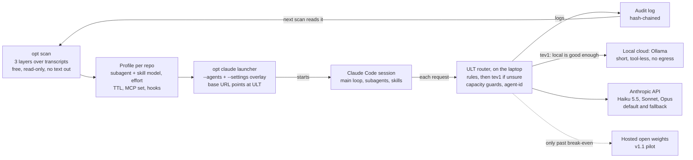
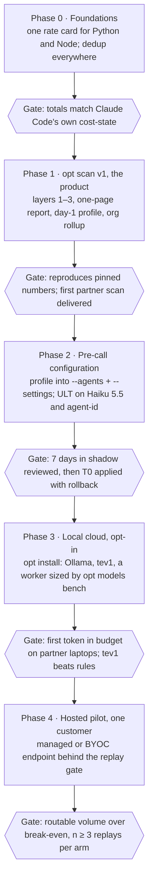

# OptHub v1: first-customer release plan

**Status:** proposal, 2026-10-24 · **Owner:** oleg@canarian.io · **Companion:** [`managed-inference-analysis.md`](managed-inference-analysis.md)
· **Numbers:** `python3 tools/hostcost.py` over [`data/e1b-sessions.csv`](data/e1b-sessions.csv), rate card `tools/ratecard.py` 2026-10-24.
Shared copy with diagrams: [Claude Doc](https://claude.ai/artifact/PrkK79QHfNLs7RXgQRyk6r).

Ship `opt scan` as the v1 product and pre-call configuration as the first thing that acts. Ship the local
cloud opt-in and in shadow. Keep a per-customer hosted model out of v1 until a customer's own scan clears
the break-even in the companion analysis.

## What ships

The scan writes a profile, the launcher applies it before the first request, and the router sends each
request to Ollama only when tev1 says local is good enough and the machine has room. Anthropic answers
everything else and every failed local call; the hosted tier waits for a customer whose numbers clear the
break-even.

## Why this order

On real Claude Code traffic the cache-read price decides the bill, so Haiku 5.5 already captures almost
all of what a free local or hosted tier could save. The shape is 96.6% cache reads, 3.4% cache writes and
0.71% output per input token (E1b, 214 sessions, writes counted at the 1h price). Short-context sessions,
the work Haiku-class tiers take, carry more writes and output: 90.7% reads, 9.3% writes, 1.68% output.

| Tier | $ per 1M input tokens, this shape | Saving vs Opus 5.5 | Note |
| --- | --- | --- | --- |
| Opus 5.5 | $0.605 | baseline | List price, 1h writes |
| Sonnet 5.5 | $0.3025 | 50.0% | Main loop on Sonnet measured 2.4–3.9× more per task (n=2, [`dynamic-config-analysis.md`](dynamic-config-analysis.md)) |
| Haiku 5.5, prompt ≤ 100K | $0.0200 | 96.7% | Settable per subagent today |
| Haiku 5.5, prompt > 100K | $0.0998 | 83.5% | The whole request reprices |
| Local Ollama | $0 marginal | 100% marginal | One replay: 7.1× cheaper, 18 points worse (n=1, [`evidence-catalog.md`](evidence-catalog.md)) |

Routing 25% of a $250 per developer-month Opus 5.5 org saves $31.25 on Sonnet 5.5, $60.71 on Haiku 5.5,
and $62.50 on a free tier. The free tier adds $1.79 over Haiku 5.5; across $150–388 per developer and
10–50% routed, that gap is $0.43–5.54 per developer-month. All `priced`: extra turns and quality loss
only shrink these.

The Haiku figures hold for subagents and side calls, which start fresh under its 100K-token price step.
On the development machine 75.5% of input dollars sit in sessions whose median request is past it, where
Haiku 5.5 blends to $0.080 per 1M input.

Configuration alone saved 12.8% of the last two weeks on the development machine ($30.21 of $235.70);
5.4 points of that are measured, the rest priced or guessed ([`dynamic-config-analysis.md`](dynamic-config-analysis.md)).

## opt scan: three layers

Most of each layer already exists as a separate tool; v1 is one command over them, one rate card under
them, and one report out of them.

| Layer | Answers | Built today | Missing for v1 |
| --- | --- | --- | --- |
| 1. Claude Code settings | Which settings to change, and the dollar delta of each, marginal in applied order | `tools/dynconfig.py` (8 levers); `tools/onboard.py` P0–P5 ([`onboarding-spec.md`](onboarding-spec.md)) | Org rollup, one-page report wired to the profile |
| 2. Model routing | Which threads move to which tier: main loop, each subagent type, each skill, background calls, priced with the prefix re-buy and the Haiku 100K step | ULT classifier and policy (shadow, one live run); J3 Jev triage over 54 sessions; `app/lib/potential.mjs` | Haiku 5.5 as a target, subagent split per type, local capacity bench, current prices in `potential.mjs` |
| 3. Other strategies | What config and routing cannot reach | Optimization Atlas, 38 scenarios (5 measured, 8 priced, 6 published, 19 guess) | A detector with a silent floor per lever |

The scan's output is a one-page report, a day-1 profile per repo (T0 changes only, applied in shadow for
7 days), and an experiment queue in which each item projects at least 3× its verification cost.

Claude Code's own `/usage` now lists attribution and recommendations and applies some with `f`
(v2.1.305+), but only on Pro, Max, Team and Enterprise plans ([costs](https://code.claude.com/docs/en/costs)).
The scan has to win on what that does not do: one view across all of an org's developers, dollar deltas
instead of usage shares, API-key and Bedrock customers, and the routing and hosting layers.

## Pre-call configuration

Every knob below is set before a request leaves the machine, so the cheap decision costs no router call.
The scan writes a profile per repo; `opt claude` renders it into `--agents` and a `--settings` overlay for
that session only, and never edits the customer's own files.

| Knob | Set with | Scope | Cache effect | v1 mode |
| --- | --- | --- | --- | --- |
| Subagent model | frontmatter `model`, `--agents` JSON, `CLAUDE_CODE_SUBAGENT_MODEL` (+ `CLAUDE_CODE_SUBAGENT_MODEL_FORCE=1` to reach built-in Explore and Plan) | Per subagent | Own cache: safe | Auto: read-only subagents to `haiku` |
| Subagent effort | frontmatter `effort`; per-invocation `effort` (v2.1.292+) | Per subagent | Own cache: safe | Auto, behind the gate |
| Subagent context | `omitClaudeMd` (v2.1.271+), `autoCompactWindow`, `experimental.cacheTtl` | Per subagent | Smaller prefix | Approve |
| Skill model | SKILL.md `model`, or `context: fork` + `agent` | Rest of the turn, or the forked subagent | On the main thread the switch re-buys the prefix; a fork has its own cache | Only with `context: fork` |
| Skill effort | SKILL.md `effort` | While the skill is active | Docs do not say whether it reverts: test before use | Approve |
| Session model and effort | `--model`, `--effort`, `effortLevel` | Read at session start | None at launch | Launch profile |
| Cache TTL | `promptCacheTtl`, `subagentPromptCacheTtl` | Session, subagent | The measured lever: 5.4% of two weeks | Auto |
| Tools and MCP | `--strict-mcp-config`, `--disallowed-tools` | Session | Set at launch: no rewrite | Auto, behind the gate |

Two traps the profile must avoid ([sub-agents](https://code.claude.com/docs/en/subagents)):

- `CLAUDE_CODE_EFFORT_LEVEL` overrides every subagent's `effort` field, so it is never set once effort is per subagent.
- A per-invocation `model` from the main agent beats the frontmatter, so a forced tier needs `CLAUDE_CODE_SUBAGENT_MODEL_FORCE=1`.

For the request-level router, Claude Code sends `x-claude-code-session-id`, `x-claude-code-agent-id` and
`x-claude-code-parent-agent-id` to any gateway ([gateway protocol](https://code.claude.com/docs/en/llm-gateway-protocol.md)).
ULT should key threads on these headers instead of hashing the system prompt and first message.

## Local cloud

The local tier earns its place on privacy and on hosting the decision model, not on price: beyond Haiku
5.5 it saves $0.43–5.54 per developer-month, and long prompts are slow on a laptop.

1. **Install.** `opt install` pins Ollama (v0.40.10 is current; Anthropic Messages API since v0.14.0), sets
   `OLLAMA_CONTEXT_LENGTH` to at least 64K as Ollama advises for coding agents, sets `OLLAMA_NUM_PARALLEL`
   (default 1) and `OLLAMA_KV_CACHE_TYPE=q8_0`, then pulls tev1 and one worker model that `opt models bench`
   sized for this machine.
2. **Decide.** Rules classify each human prompt; tev1, the Jev Choice contract served by local Ollama and
   already the default classifier of `opt analyse`, answers only when rules are unsure. The class holds for
   the turn's whole tool loop.
3. **Admit.** A request goes local only if its class is on the local allowlist, the prompt fits `num_ctx`,
   a slot is free, and the first token arrives within budget ([`local-inference-capacity.md`](local-inference-capacity.md)).
   Otherwise it goes to the profile's Anthropic model.
4. **Fall back.** Busy, slow, failed, or a malformed tool call before the first byte: retry once on the
   Anthropic model and audit the reason.
5. **Shadow, then route.** Seven days of logged decisions before any request is moved.

Speed decides the allowlist. Ollama's MLX runner preview (v0.19) reached 1,851 tokens/s prefill and 134
tokens/s decode at int4 on Apple silicon with more than 32 GB, so a 40K-token prompt with nothing cached
waits about 22 s for its first token; one third-party test waited about 3.5 minutes for a 40K prompt on an
M4 Pro. The median request on the development machine carries about 35K tokens of context (E1b). Until the
bench says otherwise, local takes background calls and short tool-less turns only.

Ollama's Anthropic endpoint does not support `cache_control`, `tool_choice` or `count_tokens`, and does not
enforce `budget_tokens` ([compatibility](https://docs.ollama.com/api/anthropic-compatibility)). Practitioners
report malformed tool-call JSON and drifting schema adherence as context grows, so every local tool call is
validated before it reaches Claude Code.

## Hosted open weights per customer

Not in v1: no first customer clears the break-even, and the open-model quality question can be tested
without any fixed cost. Full analysis: [`managed-inference-analysis.md`](managed-inference-analysis.md).

- **Instead, after phase 2:** route one open-model class to a serverless endpoint with zero data retention
  and a per-tenant cache isolation key (Fireworks serves the Anthropic API natively), shadow first, then a
  replay-graded slice. Only cached open models undercut Sonnet 5.5 on this traffic; Bedrock's uncached ones cost more.
- **When to host:** a GLM-5.2-class node on 8×H200 pays against Sonnet 5.5 from 155–726 developers on
  DeepInfra, assuming equal quality. A small model on one GPU must beat Haiku 5.5 and never breaks even:
  replicas grow with headcount faster than the Haiku work they displace. Residency is the one reason to
  self-host earlier, and in Israel that means A10G or A100.
- **What the scan must measure to decide:** Sonnet- and Opus-tier spend by thread class, the share of
  requests past 100K tokens, and whether the customer has a residency rule.

## Release gates

The first two change every number the scan prints; the Python half of both landed with the onboarding probes (PR #4).

- [x] **One rate card, Python side.** `tools/ratecard.py` (2026-10-24) prices every tool, `hostcost.py` included.
- [ ] **One rate card, Node side.** `app/lib/potential.mjs` and `app/survey.mjs` still price Opus at $15/$75;
      `app/config/ult.default.json` has no Haiku 5.5 price. One versioned card read by Python and Node.
- [x] **Dedup by message id, Python side** (`sessions.py`, `savings.py`, `lenops.py`, `loopscan.py`).
- [ ] **Dedup in the hub.** `app/lib/sessions-index.mjs` still sums per record (about 2×, PROGRESS 2026-10-23).
- [ ] **ULT on current models.** Route `non-coding/*` to Haiku 5.5, not Haiku 4.5; add 5.5 entries to the
      adapter table (thinking cannot be turned off on the 5.5 models); key threads on the agent-id headers.
- [ ] **Local guards.** `num_ctx` set by ULT, fit check, in-flight cap, time-to-first-token budget in place of
      the 120 s timeout ([`local-inference-capacity.md`](local-inference-capacity.md) layers 1–2).
- [ ] **Privacy proof.** `opt scan --dry` prints every field that leaves the machine; a test plants strings in
      a fixture and greps every output for them (`onboard.py --dry` and `test_onboard.py` already do this for P0–P5).
- [ ] **Billing path.** Customer traffic runs on the customer's API key or cloud account. Routing a
      subscription OAuth token through a proxy that rewrites requests needs the KT-6 terms review first.
- [ ] **One-command install.** The Homebrew formula ships only the Node app; the Python scan tools are not in it.
- [ ] **One brand** on the CLI, the report and the site.
- [ ] **Reproduction.** The scan reproduces the pinned numbers (`SPEC.md` §2.4 TTL deltas; lever B $13.72),
      and every routing claim in a customer report has n ≥ 3 replays or says it does not.

## Build order

Phases 0–2 are the first-customer release; phase 3 ships with it as an opt-in that stays in shadow until
its gate passes. Durations are left off on purpose: none has been measured.

## Kill criteria

Each is checked on the first design partner's own scan, cheapest first.

1. **Layer 1 is the product only if it beats `/usage`.** If the partner is on a Team or Enterprise plan and
   the scan's T0 list matches what `/usage` already recommends, lead with layers 2 and 3.
2. **Routing needs a slice.** If threads that hold quality on Haiku 5.5 are under 10% of spend, routing
   drops out of the v1 pitch and stays in shadow.
3. **Local needs speed.** If `opt models bench` on the partner's laptops misses the time-to-first-token
   budget at the context the local classes send, local serves only background calls.
4. **tev1 must beat rules.** If tev1's class labels agree with replay-graded labels no more often than rules
   do, ship rules only and keep tev1 in shadow.
5. **Hosting needs volume.** If the scan's routable volume is below the break-even in the companion
   analysis, no dedicated endpoint for that customer.

## Sources

Fetched 2026-10-24.

- Anthropic: [pricing](https://platform.claude.com/docs/en/about-claude/pricing) · [Claude Code costs and /usage](https://code.claude.com/docs/en/costs) · [sub-agents](https://code.claude.com/docs/en/subagents) · [skills](https://code.claude.com/docs/en/skills) · [gateway protocol](https://code.claude.com/docs/en/llm-gateway-protocol.md) · [other LLM gateways](https://code.claude.com/docs/en/llm-gateway) · [Haiku 5.5 100K price step, eesel](https://www.eesel.ai/blog/claude-haiku-5-5-pricing)
- Ollama: [Anthropic compatibility](https://docs.ollama.com/api/anthropic-compatibility) · [context length](https://docs.ollama.com/context-length) · [MLX runner](https://registry.ollama.ai/blog/mlx) · [releases](https://github.com/ollama/ollama/releases) · [40K prompt on an M4 Pro, Towards AI](https://pub.towardsai.net/apples-mlx-runs-local-llms-3x-faster-than-llama-cpp-until-your-context-hits-40k-715ec441afbb) · [Claude Code against a local model, 200OK](https://www.200oksolutions.com/blog/i-tried-running-claude-code-against-a-local-model-heres-where-it-broke/)
